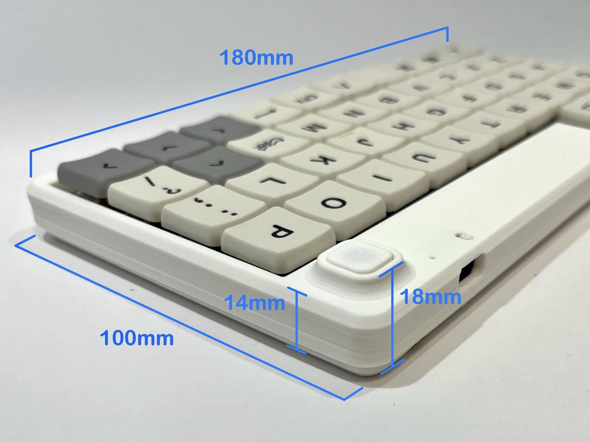
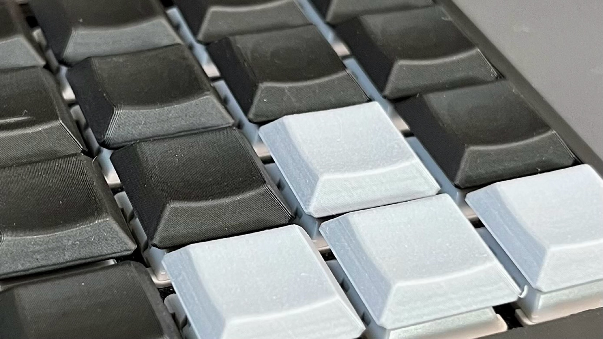
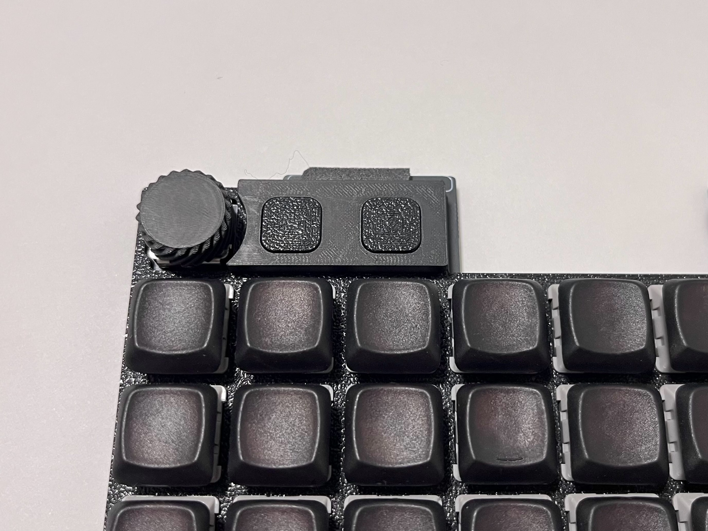

# Enigma_01 詳細説明

## 目次
1. [Enigma_01](#1-enigma_01)  
2. [商品詳細](#2-商品詳細)  
  2-1. [商品内容](#2-1-商品内容)  
  2-2. [別途必要部品](#2-2別途必要部品)  
  2-3. [購入おすすめ品](#2-3-購入おすすめ品)  
  2-4. [3DP製キーキャップ](#2-4-3dp製キーキャップ)  
  2-5. [タクトスイッチキット](#2-5-タクトスイッチキット)  
3. [使い方（ユーザーガイド）](#3-使い方ユーザーガイド)  
  3-1. [はじめての方](#3-1-はじめての方)  
  3-2. [必要なときに見るページ](#3-2-必要なときに見るページ)  
4. [搭載したカスタム機能](#4-搭載したカスタム機能モジュール)  
5. [注意事項](#5-注意事項)  
6. [更新履歴](#6-更新履歴)  

## 1. Enigma_01
Enigma_01は**17mm狭ピッチ40%キーボード**です。[40Plus](https://note.com/kazu_dob/n/n5ea06c3c5d62)([Kz](https://x.com/kazu_dob)さん)や[SPC_EVDR](https://github.com/weteor/SPC_EVDR)([weteor](https://github.com/weteor)さん)に影響を受けた背景があります。  

+ 販売は[BOOTH](https://nazuna293.booth.pm/items/7125433)で行っていきます。  
+ ユーザー向けのファームウェアは[こちら](https://github.com/nazuna293/zmk-Enigma_01-user-config)です。
+ 設計者向けのリポジトリも[公開](https://github.com/nazuna293/zmk-keyboard-Enigma_01)しています。

### 特徴
+ ZMK Firmwareによる無線接続対応
+ オーソリニア配列(42キー)
+ キーピッチ17mmの**狭ピッチ設計**
+ ロータリーエンコーダ搭載
+ [親指キー](docs/thumb_key.md)の**配列が選択可能**
+ リポバッテリー搭載可能

### 外観
寸法は(**W180×D100×H18mm​​​​​​​​​​​​​​​​​​​​​​**)で**iPad mini**にも収まります。
背面の傾斜（チルト）はありませんが、**ロープロ×狭ピッチ**により**違和感の少ない打鍵感**です。

### 初期キーマップ  

興味のある人はDiscordの[Enigma サポート開発](https://discord.gg/sYsCttWgKr)に立ち寄ってみてください。

## 2. 商品詳細
### 2-1. 商品内容
📷内容一覧  
<!-- 写真 contents.jpg：届く物（本体・キーキャップ一式・タクトスイッチキット・ディスプレイスタンド・親指キーのトッププレート3種・エンコーダノブ）を無地の背景に並べた真上からの1枚 -->

<!-- 絵 draw_parts_exploded（自動生成: 40_Scripts\個人\100_KeyboardCase\buildguide\make_scenes.py --kbd Enigma01）：部品の重なり。ケースは薄型（開発中）で描いている -->

|商品|数|備考|
|:-|:-|:-|
|Enigma_01本体|×1|[部品表](docs/parts_main.md)|
|[キーキャップ一式](#2-4-3dp製キーキャップ)|×1|[Nazuna_pick](https://nazuna293.booth.pm/items/7265342) 1.0u ×42 1.5u ×2 2.0u ×1|
|[タクトスイッチキット](#2-5-タクトスイッチキット)|×1|カスタム部品 [部品表](docs/parts_tact.md)|
|ディスプレイスタンド|×1|オマケ|
> Enigma_01本体は組み立て済みのため**はんだ付けは必要ありません**。  

> キーキャップは**狭ピッチ(17mm以下)対応のもの**が取り付け可能です。  

> リポバッテリーを搭載する場合は**別途購入、取付**する必要があります。  

### 2-2.別途必要部品
|商品|数|備考|
|:-|:-|:-|
|キースイッチ|×39~42|対応するスイッチ Choc v1、Choc v2(Kailh,Lofree)|
|USB-Cケーブル|×1|接続、充電用|
> 付属するキーキャップCherry MX軸で**Choc v2**に対応します。　　
#### 対応するスイッチ

### 2-3. 購入おすすめ品
#### 市販キーキャップ
17mm狭ピッチに対応した市販キーキャップをいくつか紹介します。
|商品|軸|取扱先|
|:-|:-|:-|
|junana mx|Cherry MX軸|[booth](https://decentkeyboards.booth.pm)|
|Kotori Blank(Proto)|Cherry MX軸|[booth](https://shakupan.booth.pm/items/6781056)|
|Chosfox|Choc v1軸|[遊舎工房](https://shop.yushakobo.jp/products/6143)|

#### リポバッテリー
無線接続の電源として本体に内蔵することが出来ます。
|商品|数|備考|
|:-|:-|:-|
||×1|[amazom](https://amzn.asia/d/9lPlnt1)|
> 取付方法、適合寸法などは[こちら](docs/battery.md)でご確認ください。

#### メンテナンス道具
|商品|数|備考|
|:-|:-|:-|
|プラスドライバー|×1|M2ネジ対応|
|キープラー|×1| |
> キーボードを分解するときに必要となります。  

### 2-4. 3DP製キーキャップ

オリジナルキーキャップ[Nazuna_pick](https://nazuna293.booth.pm/items/7265342)が付属します。狭ピッチ（17mm）のMX軸(Choc v2)で**誤タッチしづらい**ことに重点を置いた設計です。
> 積層が縦になるように取り付けることで手触りが良くなります。  

### 2-5. タクトスイッチキット

最上段の2キーをタクトスイッチに置き換えるためのキットです。取付方法は[こちら](docs/tact_sw.md)です。

## 3. 使い方（ユーザーガイド）
### 3-1. はじめての方
**[ユーザーガイド](docs/user-guide.md)** を上から順に進めてください。届いてから使い始めるまでを1ページにまとめています。

1. [商品内容を確認する](docs/user-guide.md#商品内容の確認)
2. [キースイッチとキーキャップを取り付ける](docs/user-guide.md#01-キースイッチの取り付け)
3. [電源を入れて、パソコンとつなぐ](docs/user-guide.md#03-電源を入れる)
4. [動作を確認する](docs/user-guide.md#動作を確認する)

> Choc v1 のキースイッチを使う場合は、取り付ける前に[注意事項](docs/choc_v1.md)を確認してください。

### 3-2. 必要なときに見るページ
|やりたいこと|ページ|分解|
|:-|:-|:-:|
|ファームウェアを書き込む・キーマップを変える|[ファームウェアの書き込み](docs/firmware.md)・[ユーザー向けリポジトリ](https://github.com/nazuna293/zmk-Enigma_01-user-config)|不要|
|親指キーの配列を変える|[親指キーの配列](docs/thumb_key.md)|要|
|リポバッテリーを付ける|[リポバッテリー取付方法](docs/battery.md)|要|
|最上段の2キーをタクトスイッチにする|[タクトスイッチ取り付け](docs/tact_sw.md)|要（はんだ付けあり）|
|本体を分解する・組み立て直す|[分解と組み立て直し](docs/disassembly.md)|―|
|リセットボタンが押しにくい|[リセットボタン](docs/reset_button.md)|場合による|
|うまく動かない|[うまく動かないとき](docs/troubleshooting.md)|―|

## 4. 搭載したカスタム機能（モジュール）

|モジュール|内容|
|:-|:-|
|[zmk-rgbled-widget]( https://github.com/caksoylar/zmk-rgbled-widget)|バッテリー残量や接続状況をLEDで表示|
|[zmk-layout-shift](https://github.com/kot149/zmk-layout-shift)|US配列とJIS配列のキーコード相違を解消|
|[zmk-listener](https://github.com/ssbb/zmk-listeners)|特定のキー操作を感知して指定した操作を実行|

バッテリー残量は🟩（30%↑）、🟨（10%↑）、🟥（0%↑）の3色で表示されます。
<!-- 写真 led_colors.jpg：XIAOのLEDが緑・黄・赤に点灯しているところを並べた3枚（同じ構図の接写） -->

to_ALTレイヤーに居る間はALTキーが押された状態になります。推移と離脱を検知しています。

> [!TIP]
> [kot](https://x.com/kot149_)さんの[zmk-config-roBa](https://github.com/kot149/zmk-config-roBa)がとても参考になります。キーマップ関係の[ガイド](https://github.com/kot149/zmk-config-roBa/blob/main/docs/keymap.md)は必見です。

## 5. 注意事項
> [!CAUTION]
> リポバッテリーを搭載する場合は、適切に取り扱ってください。万が一、発煙などの異常が生じた場合には使用を中止してください。適切な取り扱いについては、[こちら](https://www.baj.or.jp/battery/safety/safety16.html)の参考情報をご覧ください。 
* 本製品は個人が趣味で設計したものであり、市販品と同等の品質や安全性は保証できません。また、本製品に関する違反指摘や自警行為はご遠慮ください。 
* 製品の組み立てや使用において発生した怪我や事故、その他の損害について、販売者は一切の責任を負いません。電子部品の取り扱いやハンダ付け作業は十分に注意して安全な環境で行ってください。
* 製品のケースとキーキャップは3Dプリント品です。積層痕や反りなどは3Dプリント品特有の仕上がりとしてご理解ください。

### サポートについて
|対応します|対応しません|
|:-|:-|
|部品の不足、届いた時点での破損や初期不良（TODO: 連絡の期限）|TODO（候補: 分解・改造中の破損、リポバッテリーに起因する不具合）|

お問い合わせの際は、症状と該当箇所の写真を添えてください。TODO: 連絡先（BOOTH のメッセージ／Discord）

## 6. 更新履歴
|日付|内容|
|:-|:-|
|2026-11-24|分解と組み立て直し・キースイッチの取り付け・ファームウェアの書き込み・うまく動かないときのページを追加。ユーザーガイド（届いてから使い始めるまで）を追加し、各ページに前後のリンクを付けた|
