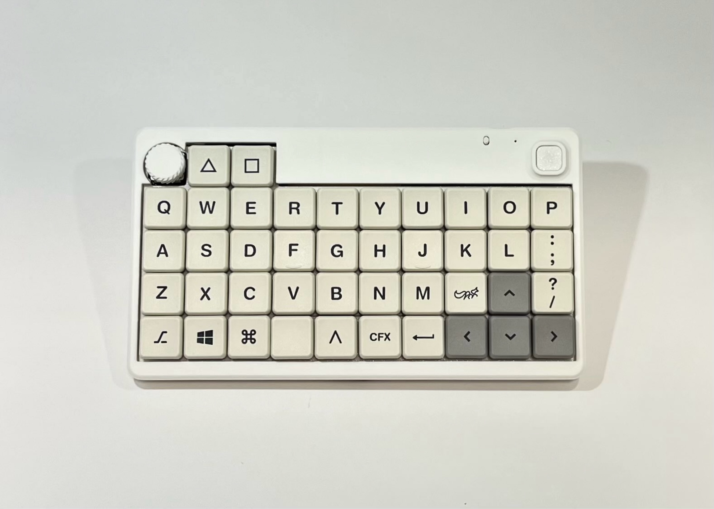
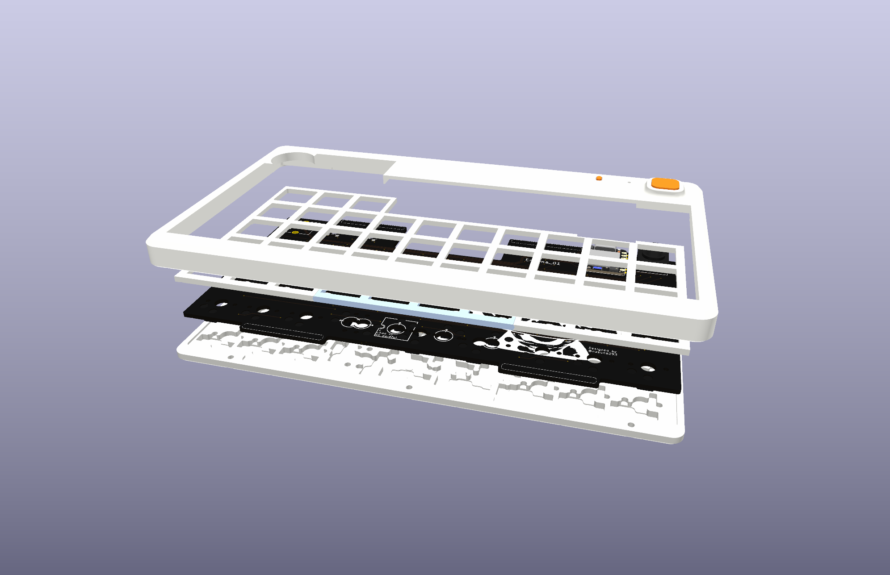
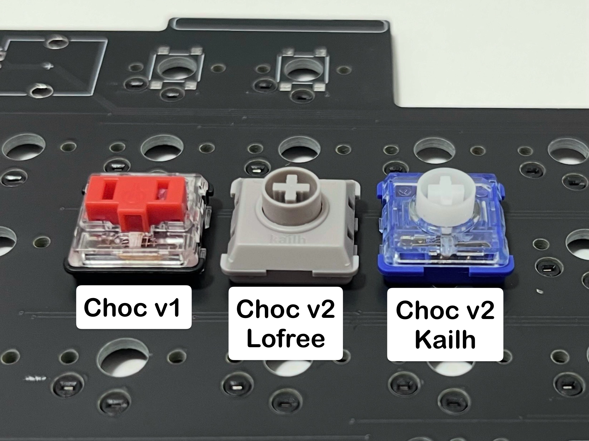
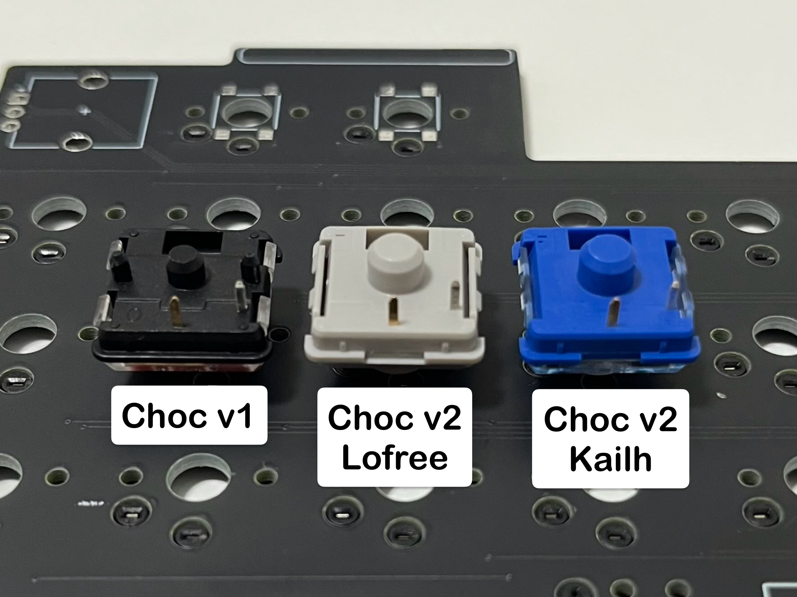

# Enigma_01 詳細説明

## 目次
1. [Enigma_01](#1-enigma_01)  
2. [キットの内容](#2-キットの内容)  
  2-1. [キットに入っているもの](#2-1-キットに入っているもの)  
  2-2. [別途用意するもの](#2-2-別途用意するもの)  
  2-3. [購入おすすめ品](#2-3-購入おすすめ品)  
3. [組み立て（ビルドガイド）](#3-組み立てビルドガイド)  
4. [搭載したカスタム機能](#4-搭載したカスタム機能モジュール)  
5. [注意事項](#5-注意事項)  
6. [更新履歴](#6-更新履歴)  

## 1. Enigma_01
Enigma_01は**17mm狭ピッチ40%キーボード**の組み立てキットです。[40Plus](https://note.com/kazu_dob/n/n5ea06c3c5d62)([Kz](https://x.com/kazu_dob)さん)や[SPC_EVDR](https://github.com/weteor/SPC_EVDR)([weteor](https://github.com/weteor)さん)に影響を受けた背景があります。  

+ 販売は[BOOTH](https://nazuna293.booth.pm/items/7125433)で行っていきます。サポートについては BOOTH の商品ページをご覧ください。
+ ユーザー向けのファームウェアは[こちら](https://github.com/nazuna293/zmk-Enigma_01-user-config)です。
+ 設計者向けのリポジトリも[公開](https://github.com/nazuna293/zmk-keyboard-Enigma_01)しています。

### 特徴
+ ZMK Firmwareによる無線接続対応
+ オーソリニア配列(42キー)
+ キーピッチ17mmの**狭ピッチ設計**
+ ロータリーエンコーダ搭載
+ [親指キー](docs/thumb_key.md)の**配列が選択可能**
+ リポバッテリー搭載可能
+ 薄型のケース

### 外観
寸法は(**W180×D100×H18mm**)で**iPad mini**にも収まります。  
TODO: 薄型ケースの寸法に更新する。
背面の傾斜（チルト）はありませんが、**ロープロ×狭ピッチ**により**違和感の少ない打鍵感**です。

### 初期キーマップ  

キーマップは [DYA Studio](https://studio.dya.cormoran.works)・[ZMK Studio](https://zmk.studio) で、書き込み直さずに画面から変えられます。レイヤーや同時押しの一覧は[ユーザー向けリポジトリ](https://github.com/nazuna293/zmk-Enigma_01-user-config)にあります。

興味のある人はDiscordの[Enigma サポート開発](https://discord.gg/sYsCttWgKr)に立ち寄ってみてください。

## 2. キットの内容
### 2-1. キットに入っているもの

<!-- 絵 draw_parts_exploded（自動生成: 40_Scripts\個人\100_KeyboardCase\buildguide\make_scenes.py --kbd Enigma01）：部品の重なり -->

基板・電子部品・ケース一式が入っています。**はんだ付けはご自身で行います**（電源ボタンと、加工が要る2か所のソケットは、はんだ付けしてお届けします）。  
数や内容の詳細は、ビルドガイドの[キットの内容](docs/build-guide.md#1-1-キットの内容)をご覧ください。

> キーキャップは付属しません。**狭ピッチ(17mm以下)対応のもの**をご用意ください。  

### 2-2. 別途用意するもの
|商品|数|備考|
|:-|:-|:-|
|キースイッチ|×41〜42|Choc v1、Choc v2(Kailh,Lofree)。Choc v1は[注意事項](docs/choc_v1.md)あり|
|キーキャップ|×41〜42|狭ピッチ(17mm以下)対応のもの|
|USB-Cケーブル|×1|接続、充電用|
|リポバッテリー|×1|任意。無線で使う場合。[選び方](docs/battery.md)|
|はんだ付けの道具|一式|[必要な工具](docs/build-guide.md#1-3-必要な工具)|

#### 対応するスイッチ

### 2-3. 購入おすすめ品
#### キーキャップ
17mm狭ピッチに対応したキーキャップをいくつか紹介します。
|商品|軸|取扱先|
|:-|:-|:-|
|[Nazuna_pick](https://nazuna293.booth.pm/items/7265342)|Cherry MX軸|booth（オリジナル。狭ピッチのMX軸で**誤タッチしづらい**ことに重点を置いた設計）|
|junana mx|Cherry MX軸|[booth](https://decentkeyboards.booth.pm)|
|Kotori Blank(Proto)|Cherry MX軸|[booth](https://shakupan.booth.pm/items/6781056)|
|Chosfox|Choc v1軸|[遊舎工房](https://shop.yushakobo.jp/products/6143)|

> Cherry MX軸のキーキャップは **Choc v2** に対応します。

#### リポバッテリー
無線接続の電源として本体に内蔵することが出来ます。大きさ・極性の確かめ方は[こちら](docs/battery.md)でご確認ください。
|商品|数|備考|
|:-|:-|:-|
|401730|×1|[amazon](https://amzn.asia/d/9lPlnt1)|

## 3. 組み立て（ビルドガイド）
**[ビルドガイド](docs/build-guide.md)** を上から順に進めてください。部品の確認から、はんだ付け・動作確認・ケースへの組み立て・パソコンとの接続までを1ページにまとめています。先頭の目次から各章へ移れます。

人によって行う作業は、別のページにまとめています。

|やりたいこと|ページ|
|:-|:-|
|ファームウェアを書き込む・キーマップを変える|[ファームウェアの書き込み](docs/firmware.md)|
|親指キーの配列を選ぶ・変える|[親指キーの配列](docs/thumb_key.md)|
|Choc v1 のキースイッチを使う|[Choc v1 の注意事項](docs/choc_v1.md)|
|リポバッテリーを付ける|[リポバッテリー取付方法](docs/battery.md)|
|組み上げた後に開ける|[分解と組み立て直し](docs/disassembly.md)|
|うまく動かない|[うまく動かないとき](docs/build-guide.md#8-うまく動かないとき)|

## 4. 搭載したカスタム機能（モジュール）

|モジュール|内容|
|:-|:-|
|[zmk-rgbled-widget]( https://github.com/caksoylar/zmk-rgbled-widget)|バッテリー残量や接続状況をLEDで表示|
|[zmk-layout-shift](https://github.com/kot149/zmk-layout-shift)|US配列とJIS配列のキーコード相違を解消|
|[zmk-feature-runtime-combo](https://github.com/cormoran/zmk-feature-runtime-combo)|同時押しを DYA Studio で編集（DYA 版だけ）|
|[zmk-feature-runtime-macro](https://github.com/cormoran/zmk-feature-runtime-macro)|マクロを DYA Studio で作成（DYA 版だけ）|

- バッテリー残量は🟩（30%↑）、🟨（10%↑）、🟥（10%未満）の3色で表示されます
- JIS 配列のパソコンでは、B を押したまま A の位置で JIS 用に切り替えます（S の位置で US 用に戻ります）
- 左上・右上のキーを押したまま反対側を押すと、アプリの切り替え（Alt+Tab・Win+Tab）になります

> [!TIP]
> [kot](https://x.com/kot149_)さんの[zmk-config-roBa](https://github.com/kot149/zmk-config-roBa)がとても参考になります。キーマップ関係の[ガイド](https://github.com/kot149/zmk-config-roBa/blob/main/docs/keymap.md)は必見です。

## 5. 注意事項
> [!CAUTION]
> リポバッテリーは、扱いを誤ると発火・発煙のおそれがあります。保護回路付きのものを使い、つなぐ前に必ず極性を確かめてください。極性が逆のもの・確かめられないものはつながず、線の入れ替えなどの改造もしないでください。発熱・膨らみ・におい・煙などの異常があれば、すぐに使用をやめてください。参考：[電池工業会の安全情報](https://www.baj.or.jp/battery/safety/safety16.html)

* 本製品は個人が趣味で設計したものであり、市販品と同等の品質や安全性は保証できません。また、本製品に関する違反指摘や自警行為はご遠慮ください。 
* 製品の組み立てや使用において発生した怪我や事故、その他の損害について、販売者は一切の責任を負いません。電子部品の取り扱いやハンダ付け作業は十分に注意して安全な環境で行ってください。
* 製品のケースは3Dプリント品です。積層痕や反りなどは3Dプリント品特有の仕上がりとしてご理解ください。

## 6. 更新履歴
|日付|内容|
|:-|:-|
|2026-11-24|分解と組み立て直し・ファームウェアの書き込みのページを追加|
|2026-11-25|組み立てキット・薄型ケースの版に変更。ビルドガイドを追加し、完成品向けのユーザーガイド・タクトスイッチキットのページを削除|
