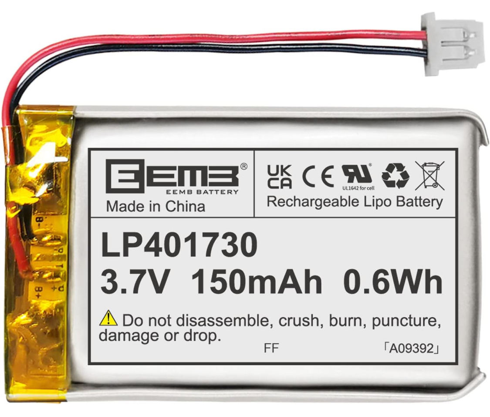
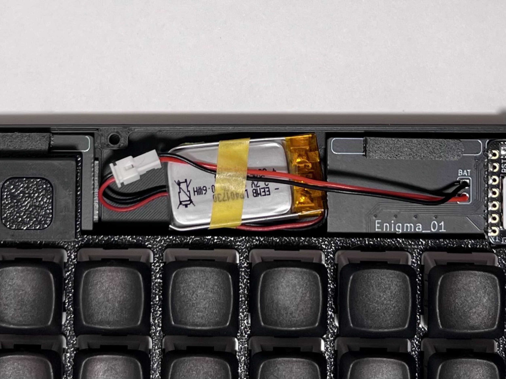
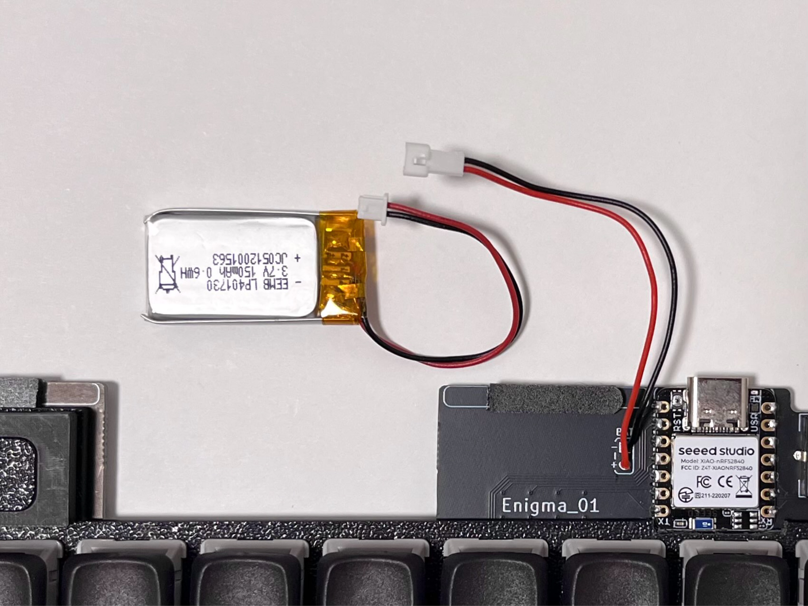

[Enigma_01 ビルドガイド](build-guide.md) ＞ 人によって行う作業

# リポバッテリー取付方法

> [!NOTE]
> **使う人**：無線で使う人（バッテリーは付属しません）  
> **この作業の前に**：[4-3 バッテリーコネクタ](build-guide.md#4-3-バッテリーコネクタ)まで終わっていること。組み上げた後なら[分解と組み立て直し](disassembly.md)  
> **難しさ**：中（極性を間違えないこと）

> [!CAUTION]
> リポバッテリーは、扱いを誤ると発火・発煙のおそれがあります。保護回路付きのものを使い、極性が逆のもの・確かめられないものはつながないでください。線の入れ替えなどの改造もしないでください。発熱・膨らみ・におい・煙などの異常があれば、すぐに電源を切ってバッテリーを外し、使うのをやめてください。参考：[電池工業会の安全情報](https://www.baj.or.jp/battery/safety/safety16.html)

## 選び方

| 項目 | 条件 |
|:-|:-|
| 種類 | 3.7V リポバッテリー、**保護回路付き** |
| コネクタ | JST 1.25mm 2ピン |
| 大きさ | 置き場所（幅39×奥行き21×高さ6.3mm）より小さいもの。目安は **401730**（厚さ4.0×幅17×長さ30mm）。劣化で膨らむことがあるので、ぎりぎりではなく余裕を持って |
| 極性 | 赤い線が＋。商品の説明と、届いた現物が違うこともあるので、**つなぐ前に現物で確かめる** |

数字の読み方：401730 は、最初の2桁が厚さ（0.1mm単位で4.0mm）、次の2桁が幅（17mm）、最後の2桁が長さ（30mm）です。

## 置き場所

バッテリーは基板の下には入れません。基板の奥の中央にある切り欠き（最上段のキーのない部分。エンコーダと XIAO の間）の、ボトムケースの床に置きます。切り欠きの左奥の角にはネジの柱があるので、柱を避けた幅39×奥行き21mmの範囲に収めます。

<!-- 絵 battery_place（自動生成）：ボトムケースと基板を上から。電池の場所（基板の切り欠きから見える床）と、ネジの柱（赤丸） -->

<!-- 写真 bat_put.jpg：電池の場所にバッテリーを置き、ケーブルを J1 まで通した状態を真上から -->

バッテリーは**両面テープでボトムケースの床に留めます**。留めずにおくと、持ち運ぶうちに動いて、線が引っ張られたり、ケースの合わせ目に挟まったりします。

## つなぎ方

1. 電源を OFF にする
2. ビルドガイドの [6-2「つなぐ前に確かめること」](build-guide.md#6-2-リポバッテリー任意)を、上から順に確かめる
3. コネクタ同士を、奥までまっすぐ差し込む。抜くときは、線ではなくコネクタの本体をつまんで引く
4. 電源を ON にして、XIAO のLEDが光ることを確かめる。USB を抜いてもキーが入力できれば、バッテリーで動いています
5. バッテリーを置き場所に両面テープで留め、線がケースの合わせ目やネジの柱に挟まらないように通して、ケースを閉じる（[6-3](build-guide.md#6-3-ケース)）

<!-- 写真 bat_pin.jpg：バッテリーのコネクタと、基板のケーブルのコネクタを並べた接写。赤い線が同じ側に来ていることを矢印で示す -->

- **充電されるのは、電源が ON のときだけです**。USB をつないでいても、OFF のままでは充電されません
- 線を強く曲げたり、ケースのふちやネジで挟んだりしないでください。被覆が破れると、ショートの原因になります

---

[← ビルドガイド 6-2 に戻る](build-guide.md#6-2-リポバッテリー任意) ｜ [目次](build-guide.md#目次)
