# Enigma_01 ビルドガイド

<!-- 写真や自動生成の絵は docs/img/ に置く。各画像の直前のコメントが撮影の構図・絵の名前 -->

Enigma_01 は、キーピッチ17mmの狭ピッチ40%キーボードのキットです。はんだ付けからご自身で組み立てます。

<!-- 絵 draw_done（自動生成: 40_Scripts\個人\100_KeyboardCase\buildguide\make_scenes.py --kbd Enigma01）：組み上がった状態を斜め前から -->
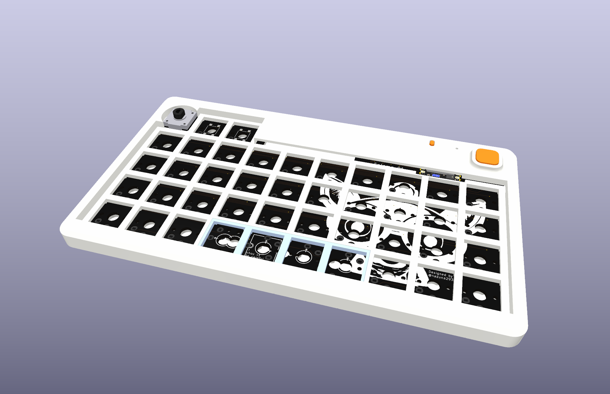

> [!NOTE]
> 図は基板とケースの設計データから描いたものです（キースイッチ・キーキャップは描いていません）。部品の色は見分けやすさのためで、実物の色とは異なります（オレンジ＝電源・リセットのボタン、青み＝差し替える親指キーのプレート）。

## 目次

0. [はじめに](#0-はじめに)
1. [部品と工具](#1-部品と工具)
2. [組み立ての前に](#2-組み立ての前に)
3. [ダイオード・ソケット](#3-ダイオードソケット)
4. [XIAO・電源・エンコーダ](#4-xiao電源エンコーダ)
5. [動作確認](#5-動作確認)
6. [ケースへの組み立て](#6-ケースへの組み立て)
7. [使い始める](#7-使い始める)
8. [うまく動かないとき](#8-うまく動かないとき)

上から順に進めてください。各章の終わりに「目次に戻る」があります。

**人によって行う作業**は、別のページにまとめています。必要になったところで本文から案内します。

| ページ | 使う人 |
|:-|:-|
| [親指キーの配列](thumb_key.md) | 1.0u／1.5u／2.0u のどれにするか決めるとき、後で変えるとき |
| [Choc v1 の注意事項](choc_v1.md) | Choc v1 のキースイッチを使う人（**ソケットを付ける前に**読む） |
| [リポバッテリー取付方法](battery.md) | 無線で使う人 |
| [ファームウェアの書き込み](firmware.md) | ファームを入れる・キーマップを変えるとき |
| [分解と組み立て直し](disassembly.md) | 組み上げた後に開けるとき |

---

## 0. はじめに

### 作業の流れ

基板の**下の面**にダイオードとPCBソケット、**上の面**に XIAO・バッテリーコネクタ・エンコーダを付けます（電源スイッチは付けてお届けします）。

1. 下の面：ダイオード → PCBソケット（[3章](#3-ダイオードソケット)。付属のスタンドで基板を浮かせて作業します）
2. 上の面：XIAO → バッテリーコネクタ（無線で使う場合）→ エンコーダ（[4章](#4-xiao電源エンコーダ)）
3. ケースに入れる前に、全部のキーを確かめる（[5章](#5-動作確認)）
4. ケースに組む（[6章](#6-ケースへの組み立て)）

### ご購入・組み立ての前に

- 組み立て後に動かない原因のほとんどは、はんだ付け（付け忘れ・ブリッジ・部品の向き）です。特にダイオードは数が多く、**向きを1つでも逆にすると、そのキーが反応しません**。症状ごとの確かめ方は [8章](#8-うまく動かないとき)にまとめています
- ケースに入れる前に、[5. 動作確認](#5-動作確認)を必ず行ってください
- 部品の不足・破損などのサポートについては、BOOTH の商品ページをご覧ください

### 注意事項

**組み立て・使用は、ご自身の責任で行ってください**。組み立てや使用によって生じた怪我・事故・損害について、責任は負いかねます。

- 本製品は個人が趣味で設計したもので、市販品と同等の品質や安全性は保証できません
- 本製品に関する違反の指摘や自警行為はご遠慮ください
- ケースは3Dプリント品です。積層の跡や反りは、3Dプリント品の仕上がりとしてご理解ください
- はんだ付けは、換気のよい場所で、こて台を使って行ってください

> [!CAUTION]
> リポバッテリーは、扱いを誤ると発火・発煙のおそれがあります。
> - 保護回路付きのものを使ってください
> - つなぐ前に、必ず極性を確かめてください（[6-2](#6-2-リポバッテリー任意)）。極性が逆のもの・確かめられないものはつながず、線の入れ替えなどの改造もしないでください
> - 発熱・膨らみ・におい・煙などの異常があれば、すぐに電源を切ってバッテリーを外し、使うのをやめてください
>
> バッテリーの取り扱いによって生じた事故・損害について、責任は負いかねます。参考：[電池工業会の安全情報](https://www.baj.or.jp/battery/safety/safety16.html)

[↑ 目次に戻る](#目次)

---

## 1. 部品と工具

### 1-1. キットの内容

<!-- 写真 01_kit.jpg：キットの中身を全部並べた真上からの1枚。基板は表を上にして中央、ケースの部品は周りに、小物（ダイオード・ソケット・ネジ）は袋から出して小皿か袋ごと表の順に並べる。背景は無地 -->

**電子部品**（「キットの数」は予備を含みます）

| 名前 | キットの数 | 使う数 | 備考 |
|:-|-:|-:|:-|
| メイン基板 | 1枚 | 1 | 電源スイッチと、最下段の2か所のソケットは付けてあります |
| XIAO nRF52840 | 1個 | 1 | |
| ダイオード | 58個 | 56 | 表面実装 |
| PCBソケット | 45個 | 43 | Kailh Choc v1/v2 用 |
| ロータリーエンコーダ | 1個 | 1 | |
| バッテリーコネクタ（ケーブル付き） | 1個 | 1 | 無線で使う場合に付ける |

- ダイオードは56か所すべてに付けます。Enigma_01 は少ない線で多くのキーを読む配線（チャーリープレクシング）のため、キーの数より多くのダイオードが要ります
- `SW16`・`SW43` のソケットは向きが90°回っていて、取り付けに加工が要るため、はんだ付けしてお届けします
- 基板の `SW46`・`SW48`（タクトスイッチの足跡）は使いません

**ケース（3Dプリント品）**

| 名前 | 数 | 備考 |
|:-|-:|:-|
| アッパーケース | 1 | ネジ用のインサートは埋め込んだ状態でお届けします |
| ボトムケース | 1 | |
| メイントッププレート | 1 | |
| 親指キーのトッププレート | 3 | 1.0u・1.5u・2.0u。使う配列の1枚を付けます（[6-1](#6-1-親指キーの配列を選ぶ)） |
| リセットボタン | 1 | アッパーケースに入れる小さな部品 |
| 電源ボタンカバー | 1 | アッパーケースに入れる小さな部品 |
| エンコーダノブ | 1 | |

**その他**

| 名前 | 数 | 備考 |
|:-|-:|:-|
| M2ネジ | 6本 | M2×6mm。ボトムケースの裏から、アッパーケースのインサートにねじ込む |
| 滑り止めシール | 4枚 | 直径5mm。ボトムケースの裏のくぼみに貼る |
| はんだ付けスタンド | 4個 | 3Dプリント品。下の面をはんだ付けするとき、基板を水平に浮かせる（[3章](#3-ダイオードソケット)） |

### 1-2. 別途用意するもの

| 名前 | 数 | 備考 |
|:-|-:|:-|
| キースイッチ | 41〜42個 | Choc v1・Choc v2（Kailh、Lofree）。数は[親指キーの配列](thumb_key.md#3つの配列)で変わる |
| キーキャップ | 41〜42個 | 狭ピッチ（17mm以下）対応。[おすすめ](../README.md#2-3-購入おすすめ品) |
| リポバッテリー | 1個 | 無線で使う場合。[選び方](battery.md#選び方) |
| USB Type-C ケーブル | 1本 | 書き込み・充電用。データ通信ができるもの |

### 1-3. 必要な工具

| 名前 | 備考 |
|:-|:-|
| はんだごて・こて台・はんだ | こては温度調整できるもの。はんだは 0.6〜0.8mm |
| フラックス | XIAO の裏のパッドに使う |
| ピンセット | ダイオードの位置合わせ |
| プラスドライバー | 精密ドライバーの +0（PH0）。+1 だとネジの頭をなめやすい |
| マスキングテープ | スタンド・部品の仮止め |
| 両面テープ | バッテリーを付ける場合 |

あれば便利なもの：はんだ吸取線（付け直し）、テスター（ショートの確認）、キープラー（キーキャップ・キースイッチを外すとき）、こて先は先が平らな C型が XIAO に当てやすい

[↑ 目次に戻る](#目次)

---

## 2. 組み立ての前に

### 2-1. 基板の表と裏

このガイドでは、使うときに上を向く面を「**上の面**」、下を向く面を「**下の面**」と呼びます。

| | 付ける部品 |
|:-|:-|
| 上の面（XIAO の枠が印刷された面） | XIAO（`U1`）・バッテリーコネクタ（`J1`）・エンコーダ（`SW47`）。電源スイッチ（`SW49`）は付けてあります |
| 下の面 | ダイオード・PCBソケット |

<!-- 絵 02_sides_upper / 02_sides_lower（自動生成）：届いた基板を上の面と下の面から -->
**上の面**

**下の面**

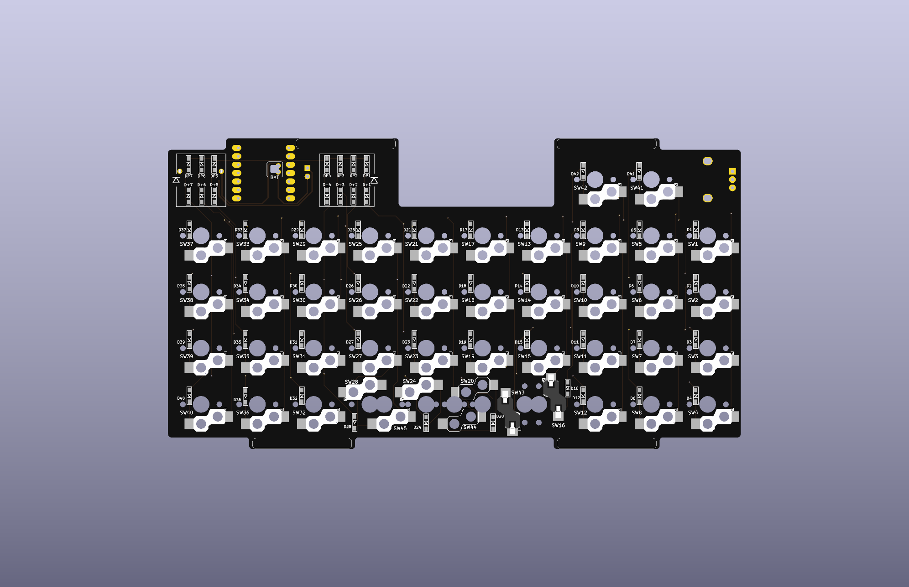

### 2-2. ファームウェアの用意

途中の確認（[4-2](#4-2-途中の確認)）と動作確認（[5章](#5-動作確認)）で使います。ファームは親指キーの配列ごとに分かれているので、先に配列を決めておきます。決めた配列は、ケースに組むとき（[6-1](#6-1-親指キーの配列を選ぶ)）のトッププレートにも使います。

| 配列 | キースイッチの数 | ファーム（.uf2） |
|:-|-:|:-|
| 1.0u | 42個 | `Enigma_01 layout_a` |
| 1.5u | 41個 | `Enigma_01 layout_b` |
| 2.0u | 41個 | `Enigma_01 layout_c` |

- それぞれの形は、[親指キーの配列](thumb_key.md#3つの配列)の絵で確かめられます
- 迷ったら 1.0u で進めて、後から変えてもかまいません。Choc v1 は 1.0u だけです

入手と書き込みの手順は [ファームウェアの書き込み](firmware.md) にあります。キーマップを変えない場合は、ビルド済みのファームをダウンロードするだけで使えます（GitHub のアカウントは不要）。

### 2-3. はんだ付けのコツ

このガイドの部品は、どれも次の順番で付けると失敗しにくくなります。

1. **フラックスを薄く塗る**：はんだが流れないときの原因の多くは、パッドの表面の汚れや酸化です。フラックスがそれを取り除きます
2. **片側のパッドに、先にはんだを盛る**（予備はんだ）
3. **部品を置き、盛ったはんだを溶かして片側だけ固定する**：位置がずれていたら、ここで直します
4. **残りの側を付ける**：こてを当てる時間は短く。長く当てると、部品や基板を傷めます

- うまく流れないときは、はんだを足すより先に、フラックスを足してみてください
- 失敗しても、吸取線ではんだを取れば付け直せます。焦らず進めてください
- XIAO のはんだ付けに不安がある場合は、練習用の基板で試してから取りかかると安心です。TALPKEYBOARD の [XIAO Practice Board（XIAO用はんだづけ練習基板）](https://shop.talpkeyboard.com/products/xiao-practice-board)は、XIAO の形をしたダミーの基板で、本物の XIAO を使わずに練習できます

[↑ 目次に戻る](#目次)

---

## 3. ダイオード・ソケット

> [!NOTE]
> **やること**：下の面に、ダイオードとPCBソケットをはんだ付けする  
> **使う部品**：ダイオード56個・PCBソケット43個・はんだ付けスタンド4個  
> **使う工具**：はんだごて・はんだ・フラックス・ピンセット・マスキングテープ

> [!IMPORTANT]
> **Choc v1 のキースイッチを使う場合は、ソケットを付ける前に [Choc v1 の注意事項](choc_v1.md) を読んでください。**

### 基板の置き方

上の面に電源スイッチが付いているので、そのままでは下の面を上にして平らに置けません。付属のはんだ付けスタンドで基板を浮かせます。

1. 4つのスタンドのピンを、上の面から四隅のキーの中心の穴（`SW1`・`SW4`・`SW37`・`SW40`）にはめる
2. 上の面を下にして机に置く
3. スタンドをマスキングテープで机に留める。ソケットを押し込んでも動かなくなります

<!-- 絵 03_stand（自動生成）：上の面から見た基板と、スタンドをはめる4つの穴（赤丸） -->
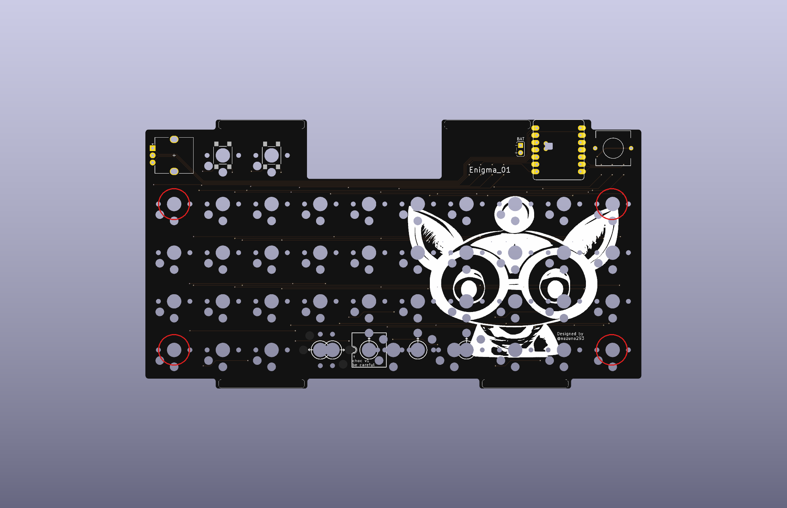

### 3-1. ダイオード

ダイオードには向きがあります。本体の線と、基板の印刷（シルク）の線を同じ側にそろえます。56か所すべてに付けます。

> [!WARNING]
> 向きを逆に付けると、そのキーが反応しません。付け直しはできますが、ソケットを付けた後だと手間が増えます。**数個付けたら、向きがそろっているか見直してください。**

1. パッドの片側にはんだを盛る
2. ピンセットでダイオードを持ち、盛ったはんだを溶かしながら置く
3. 反対側をはんだ付けする

<!-- 絵 03_diode_where（自動生成）：下の面の全体。ダイオードを付ける56か所を赤丸で囲む -->
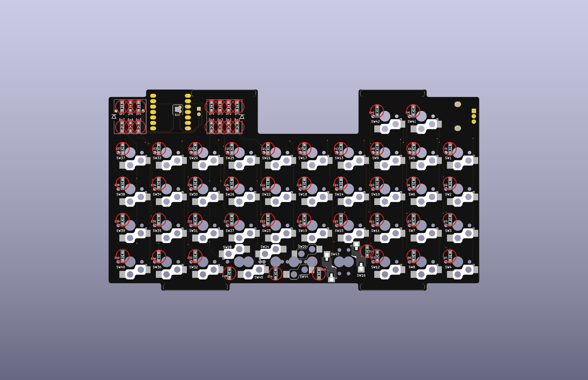
<!-- 写真 03_diode_close.jpg：ダイオード1個の接写。左に「片側にはんだを盛った状態」、右に「付け終わった状態」を並べる。ダイオードの線とシルクの線が同じ側にあるのが分かる角度（真上） -->

### 3-2. PCBソケット

ソケットを基板の穴にはめ、片側ずつはんだ付けします。`SW16`・`SW43` は付けてあるので、残りの43か所です。

最初の1個を付けたら、キースイッチを差し込んで、向きと浮きがないかを確かめてから残りに進むと安心です。

1. ソケットを基板の穴にはめる（向きは穴の形で決まります）
2. ソケットを指で押さえたまま、片側の端子をはんだ付けする
3. 浮いていないか確かめてから、反対側をはんだ付けする

<!-- 写真 03_socket_close.jpg：ソケット1個の接写を斜め45度から。ソケットの金属端子とパッドの間にはんだが流れて、ソケットが浮いていない様子 -->

<!-- 絵 03_socket_done（自動生成）：ダイオードとソケットを付け終えた下の面の全体 -->
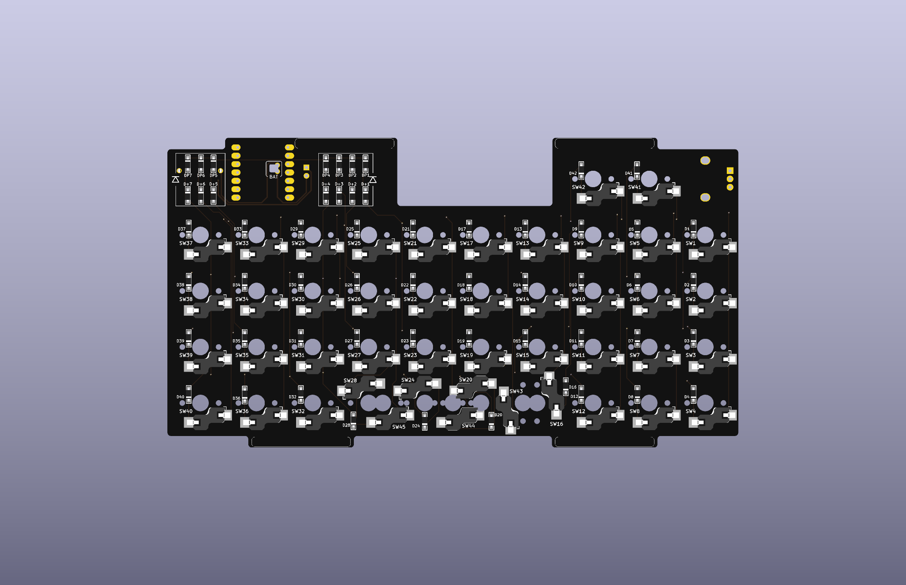

**ここまでの確認**

- [ ] ダイオード56個の向き（本体の線とシルクの線が同じ側）
- [ ] ソケット45個（付けた43個＋届いた時点の2個）に浮きがない

[↑ 目次に戻る](#目次)

---

## 4. XIAO・電源・エンコーダ

> [!NOTE]
> **やること**：上の面に、XIAO・バッテリーコネクタ（無線で使う場合）・エンコーダを付ける  
> **使う部品**：XIAO・ケーブル付きバッテリーコネクタ・ロータリーエンコーダ・はんだ付けスタンド  
> **使う工具**：はんだごて・フラックス・マスキングテープ

部品は上の面に載せますが、はんだ付けの一部（XIAO の裏の穴・バッテリーコネクタの線・エンコーダの足）は**下の面**で行います。下の面を上にするときは、[3章](#基板の置き方)と同じくスタンドに載せてください。

### 4-1. XIAO

**難易度が高い工程です**。XIAO のはんだ付けに慣れていない場合は、練習用の基板（[2-3](#2-3-はんだ付けのコツ)）で一度試してから取りかかってください。

上の面の枠（`U1`）に付けます。側面の14端子に加えて、**XIAO の裏面にあるバッテリーのパッド2つ（BAT+・BAT−）もはんだ付けします**。ここがつながっていないと、バッテリーで動かず、充電もされません。

裏面のパッドは、XIAO を載せた後では見えません。基板のパッドの位置には穴があいていて、**下の面から穴にはんだを流し込んで**つなぎます。

1. XIAO の裏面の2つのパッドにフラックスを塗る
2. XIAO を基板の枠に合わせて載せ、マスキングテープで固定する
3. 側面の端子を、対角の2か所だけ先にはんだ付けして位置を決める
4. 残りの側面の端子をはんだ付けする
5. 基板を裏返して、スタンドに載せる
6. 下の面から2つの穴にこて先を当ててから、はんだを少しずつ流し込む（穴が埋まり、表面がふくらめば OK）

<!-- 写真 04_xiao_done.jpg：付け終えた XIAO を斜め45度から。側面の端子にはんだが富士山形に乗っている様子が分かるように、片側の端子の列に寄る -->

<!-- 絵 04_xiao_holes（自動生成）：下の面から見た2つの穴（U1 の 20・21 番）を赤丸で -->
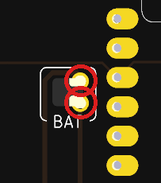

> [!WARNING]
> 穴に流し込みすぎると、XIAO の裏で BAT+ と BAT− がつながる（ショートする）ことがあります。流し込むはんだは、穴が埋まる程度にとどめてください。側面の端子も、隣同士がはんだでつながっていないか目で確かめます。テスターがあれば、BAT+ と BAT− の間がつながっていないことも確かめておくと安心です。

### 4-2. 途中の確認

バッテリーコネクタなどを付ける前に、XIAO が動くことを確かめておきます。

1. [ファームウェアの書き込み](firmware.md)の手順で、選んだ配列のファームを書き込む（このときは、XIAO のリセットボタンを直接2回押します）
2. コピーの後にドライブが消え、パソコンにキーボードとして認識されれば OK

### 4-3. バッテリーコネクタ

**無線で使う場合だけ**付けます。有線だけで使う場合は、この節を飛ばしてかまいません（後から付けることもできます）。

上の面の `J1`（`BAT` の印刷）に、ケーブル付きのコネクタの線をはんだ付けします。**赤い線を `+`、黒い線を `−` の穴に**付けます。

1. 線の長さを、基板から**30mm くらい**にそろえる（電池の場所まで届き、余りすぎない長さ）
2. 線を上の面から穴に差し込む
3. 基板を裏返してスタンドに載せ、下の面ではんだ付けする
4. 下の面に出た線の先を、1.5mm 以内に切る（ボトムケースに当たらないように）

<!-- 絵 draw_battery_polarity（自動生成）：J1 の ＋（2番ピン、B+）を下の面から -->
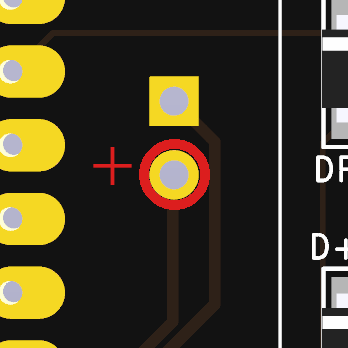

> [!CAUTION]
> - `+` と `−` を逆に付けると、バッテリーをつないだときに XIAO が壊れたり、バッテリーが発熱したりするおそれがあります。付けた後に、線の色と印刷の `+`・`−` を見比べてください
> - `+` と `−` の穴がはんだでつながると短絡し、発熱・発火のおそれがあります。2つの穴の間にはんだが渡っていないか、目でよく確かめてください

### 4-4. ロータリーエンコーダ

1. エンコーダの足を、**上の面から**基板の穴（`SW47`）に差し込む
2. 基板から浮かないように押さえたまま、裏返してスタンドに載せる
3. 下の面ではんだ付けする

<!-- 絵 04_encoder（自動生成）：部品を付け終えた基板を斜め前から。左奥がエンコーダ -->
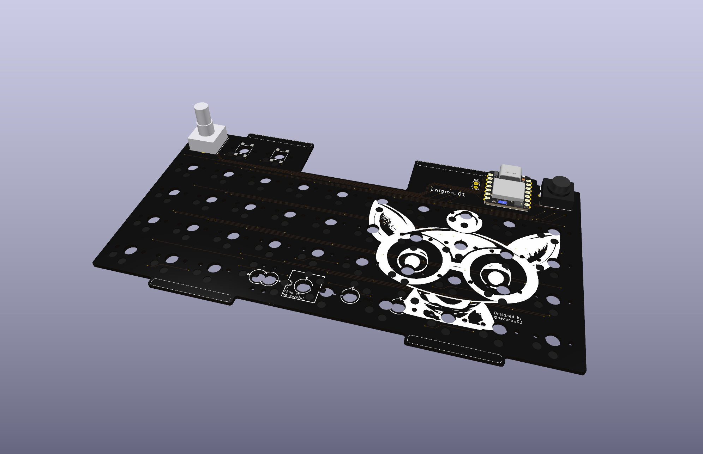

**ここまでの確認**

- [ ] XIAO の側面14端子と、下の面の2つの穴（BAT+・BAT−）。隣同士がはんだでつながっていない
- [ ] エンコーダが浮いていない
- [ ] （無線で使う場合）バッテリーコネクタの赤い線が `+`、黒い線が `−`。2つの穴の間にはんだが渡っていない

[↑ 目次に戻る](#目次)

---

## 5. 動作確認

> [!NOTE]
> **やること**：ケースに入れる前に、全部のキーが入力できるかを確かめる  
> **使う物**：USB-Cケーブル・パソコン・キースイッチ（またはピンセット）

1. XIAO に、選んだ配列のファームを書き込む（[4-2](#4-2-途中の確認)で書き込んでいれば不要）
2. USB でパソコンにつなぐ
3. 上の面から、ソケットにキースイッチを差し込んで押し、キーが入力されるかを1つずつ確かめる（何個かのスイッチを差し替えながらでかまいません）。ピンセットでソケットの2つの穴に同時に触れても確かめられます
4. エンコーダを回して、入力が出ることを確かめる
5. 入力されないキーがあれば、[8. うまく動かないとき](#8-うまく動かないとき)を見る

> [!IMPORTANT]
> **ここで全部のキーが入力できるまで、ケースに進まないでください**。ケースに入れた後は、はんだを直すのに分解が要ります。

[↑ 目次に戻る](#目次)

---

## 6. ケースへの組み立て

> [!NOTE]
> **やること**：親指キーのプレートを選び、ケースに組み、キースイッチを付ける  
> **使う部品**：ケース一式・M2×6mm ネジ6本・滑り止めシール4枚・リポバッテリー（任意）  
> **使う工具**：プラスドライバー（+0）・マスキングテープ

<!-- 絵 draw_parts_exploded（自動生成）：部品の重なり -->
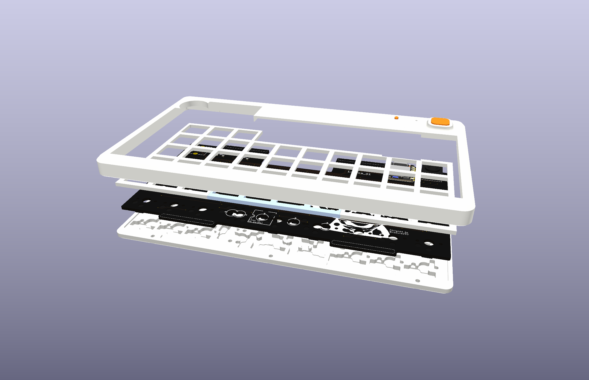

> 下から、ボトムケース・基板・トッププレート（親指キーのプレートは差し替え式）・アッパーケースの順に重なります。電源ボタンカバーとリセットボタンは、アッパーケースに入れる小さな部品です（図のオレンジ）。

### 6-1. 親指キーの配列を選ぶ

親指キーのトッププレートを、使う配列（1.0u／1.5u／2.0u）の1枚にします。配列の違いと差し替え方は [親指キーの配列](thumb_key.md) にあります。ファームも同じ配列のものを使います（[2-2](#2-2-ファームウェアの用意)）。

### 6-2. リポバッテリー（任意）

無線で使う場合は、ここでバッテリーをつなぎます。選び方と置き場所は [リポバッテリー取付方法](battery.md) にあります。

**つなぐ前に確かめること**

- [ ] 電源が OFF になっている
- [ ] `J1` の `+` と `−` の穴の間に、はんだが渡っていない（[4-3](#4-3-バッテリーコネクタ)）
- [ ] バッテリーの赤い線が、基板のケーブルの赤い線と同じ側に来る（コネクタを並べて見比べる）
- [ ] バッテリーが膨らんでいない。線の被覆が破れていない

> [!CAUTION]
> 赤い線が＋の一般的なバッテリーなら、そのまま合います。ただ、まれに製造ミスでコネクタが逆向きに付いていることがあります。**赤い線が逆の側に来るバッテリーは、つながないでください**。線を入れ替えて使うことはできません。別のバッテリーを用意してください。

### 6-3. ケース

アッパーケースを裏返して、その中に部品を重ねていきます。ボトムケースの側から組むより、USB端子を納めやすくなります。

1. アッパーケースを裏返して置く
2. **電源ボタンカバー**と**リセットボタン**を、それぞれの穴に入れ、マスキングテープで留める
3. メイントッププレートに、選んだ親指キーのプレートをはめる
4. 基板にトッププレートを重ねる
5. USB端子をケースの切り欠きに先に合わせてから、基板を寝かせてアッパーケースに入れる
6. バッテリーを付けている場合は、電池の場所（[置き場所](battery.md#置き場所)）のボトムケースの床に、両面テープで留める
7. バッテリーの線を、ケースの合わせ目に挟まらないように通す
8. ボトムケースをかぶせ、基板・USB端子・バッテリーの収まりを確かめる
9. ボトムケースの裏から、ネジ6本を締める（止まったところで止める。締めすぎるとケースが割れることがあります）
10. 裏の4つのくぼみに、滑り止めシールを貼る
11. 電源ボタンを押して、XIAO のLEDが光ることを確かめる

<!-- 絵 draw_backside_screws（自動生成）：本体の裏のネジ6本の位置 -->
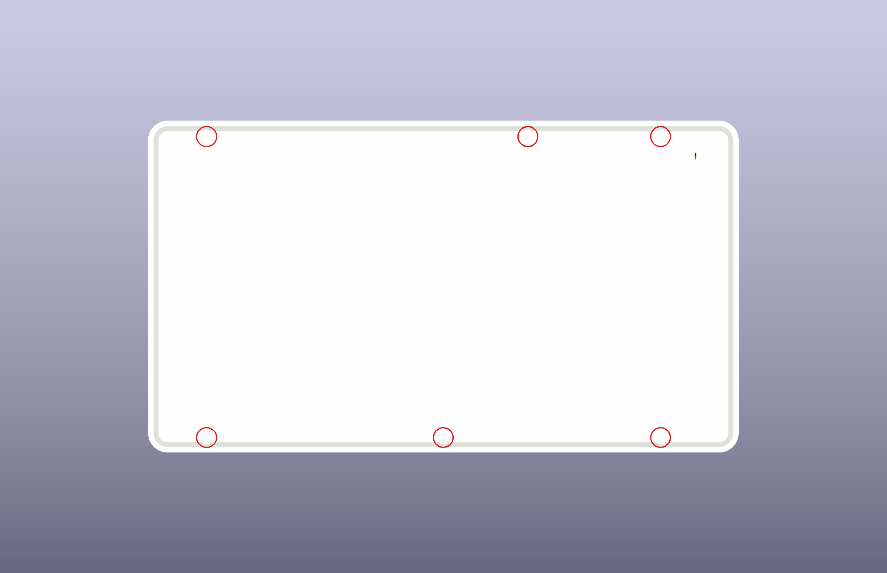

<!-- TODO: 薄型ケースでの組み付け順（トッププレートを基板に重ねる順番、テープが要るか）を試作品で確かめる -->

### 6-4. キースイッチ・キーキャップ・ノブ

Choc v1 のキースイッチを使う場合は、最下段の左から4つ目を横向きに付けます（[Choc v1 の注意事項](choc_v1.md)）。

1. キースイッチの2本のピンがまっすぐか確かめる。曲がっていたら、ピンセットでまっすぐに戻す
2. ピンをトッププレートの穴とソケットに合わせ、真上から「パチッ」とはまるまで押し込む
3. キーキャップを付ける
4. エンコーダの軸の平らな面と、ノブの穴の平らな面を合わせて、ノブを差し込む

斜めに押し込むとピンが曲がり、そのキーが反応しなくなります。反応しないキーがあるときは、スイッチを抜いてピンを確かめてください。抜くときは、キープラーでキーキャップを外したあと、キースイッチの上下のツメを押さえながら真上に引き抜きます。

**完成！** おつかれさまでした。

- [ ] 電源ボタンで ON・OFF が切り替わる
- [ ] 全部のキーが入力できる（キースイッチを付けた後にもう一度）
- [ ] エンコーダを回すと入力が出る
- [ ] USB を抜いても、バッテリーで動く（バッテリーを付けた場合）

[↑ 目次に戻る](#目次)

---

## 7. 使い始める

<!-- 絵 draw_power_reset_top（自動生成）：上から見た電源ボタンとリセットボタン -->
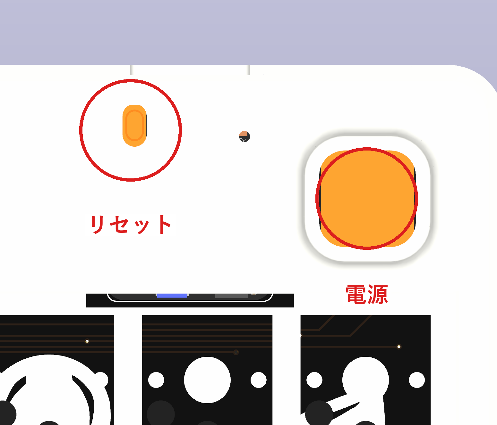

電源ボタンは押すたびに ON・OFF が切り替わります。リセットボタンは、ファームを書き換えるとき（[7-2](#7-2-ファームの書き換え)）に使います。

### 7-1. パソコンとの接続

**有線**：USB-Cケーブルでパソコンとつなぐと、そのまま使えます。

**無線（Bluetooth）**

1. 電源ボタンを押して電源を入れる
2. パソコンの Bluetooth の設定で「Enigma_01」を選んでペアリングする（1台目は `BT_SEL0`）
3. 2台目以降は、`BT_SEL1`〜`BT_SEL4` で切り替えてからペアリングする

- ペアリングの情報は `BT_CLR_ALL` で消せます
- リポバッテリーは、**電源がオンのときだけ**充電されます。USB だけで使う場合も、電源はオンにしてください
- XIAO のLEDの色でバッテリー残量が分かります（🟩30%以上、🟨10%以上、🟥10%未満）

### 7-2. ファームの書き換え

アッパーケースのリセットボタン（[7章](#7-使い始める)の図）をすばやく2回押すと、書き込み待ちの状態になります。あとは [ファームウェアの書き込み](firmware.md#書き込む) と同じです。

キーマップを変えたいときは、[キーマップを変える](firmware.md#キーマップを変える)を見てください。

[↑ 目次に戻る](#目次)

---

## 8. うまく動かないとき

原因を探すときは、次の順に確かめると絞り込みやすくなります。

1. **症状の形を見る**：反応しないのが1キーだけか、まとまった数のキーか、全部か
2. **目で見る**：疑う場所のはんだを、スマートフォンのカメラで拡大して見る（付け忘れ・ブリッジ・ダイオードの向き）
3. **付け直す**：怪しいはんだは、フラックスを足して付け直す。テスターがあれば、つながるべき場所がつながっているかも確かめられます

| 症状 | 確かめること |
|:-|:-|
| 1つのキーだけ反応しない | キースイッチのピンが曲がっていないか。別のスイッチと入れ替えて、スイッチとソケットのどちらが原因かを切り分ける。そのキーのダイオードの向きとはんだ、ソケットのはんだ |
| まとまった数のキーが反応しない | XIAO の側面の端子のはんだ。チャーリープレクシングでは、1本の端子が複数の段・列にまたがるので、同じ端子につながるキーがまとめて反応しなくなります |
| ほかのキーと違う文字が入力される | 親指キーの配列とファーム（`layout_a`／`b`／`c`）が合っているか。ダイオードの向き |
| 記号の位置がずれる（US配列とJIS配列） | パソコン側のキーボードの設定。Enigma_01 には US配列とJIS配列の違いを吸収する機能があります（[README](../README.md#4-搭載したカスタム機能モジュール)） |
| エンコーダが反応しない | エンコーダの足のはんだ |
| Bluetooth でつながらない | `BT_CLR_ALL` でペアリングの情報を消し、パソコン側の登録も削除してから、もう一度ペアリングする |
| バッテリーで動かない・充電されない | 電源がオンか。XIAO 裏面の BAT+・BAT− の穴のはんだ、バッテリーの極性 |
| バッテリーが熱い・膨らんでいる | すぐに電源を切ってバッテリーを外し、使うのをやめる。極性が逆でなかったか確かめる |
| ファームの書き込みでエラーが出る | 書き込みは終わっています。「スキップ」を押して先へ（[書き込む](firmware.md#書き込む)） |

[↑ 目次に戻る](#目次)

---

## 更新履歴

| 日付 | 内容 |
|:-|:-|
| 2026-11-25 | 組み立てキット・薄型ケースの版として、ビルドガイドを作成 |

読んでいて分かりにくかったところや、組み立てで困ったところがあれば教えてください。ガイドに反映します。

[↑ 目次に戻る](#目次)
