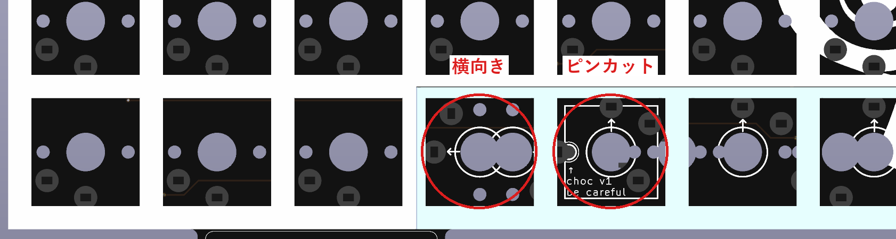

[Enigma_01 ビルドガイド](build-guide.md) ＞ 人によって行う作業

# Choc v1 の注意事項

> [!NOTE]
> **使う人**：Choc v1 のキースイッチを使う人  
> **いつ読むか**：[3章](build-guide.md#3-ダイオードソケット)でソケットを付ける**前に**。キースイッチを付けるとき（[6-4](build-guide.md#6-4-キースイッチキーキャップノブ)）にもう一度  
> **使う道具**：ニッパー（ピンカット）  
> **難しさ**：低

狭ピッチで複数の配列に対応する設計のため、Choc v1 のキースイッチを使う場合は、次の点に注意してください。

<!-- 絵 draw_choc_v1（自動生成）：プレートを付けた上の面の最下段。左から4つ目＝横向き、5つ目＝ピンカット -->

## 1.0u 配列のみ対応

狭ピッチに対応した市販のキーキャップは 1.0u しか見当たりません。1.5u 配列・2.0u 配列を使う場合は、Choc v2 のキースイッチを使ってください。

## ピンカット

1.0u 配列で Choc v1 を使う場合は、**上から見て最下段の左から5つ目**（基板に「choc v1 be careful」と印刷された所）のキースイッチの足を、1本切る必要があります。

## 取り付けの向き

**最下段の左から4つ目**のスイッチは横向き（90°）に付けます。それに合わせて、**キーキャップの印字も横向き**になります。アルファベットが印字されたキーキャップを割り当てるには向きません。

---

[← ビルドガイド 3章に戻る](build-guide.md#3-ダイオードソケット) ｜ [目次](build-guide.md#目次)
