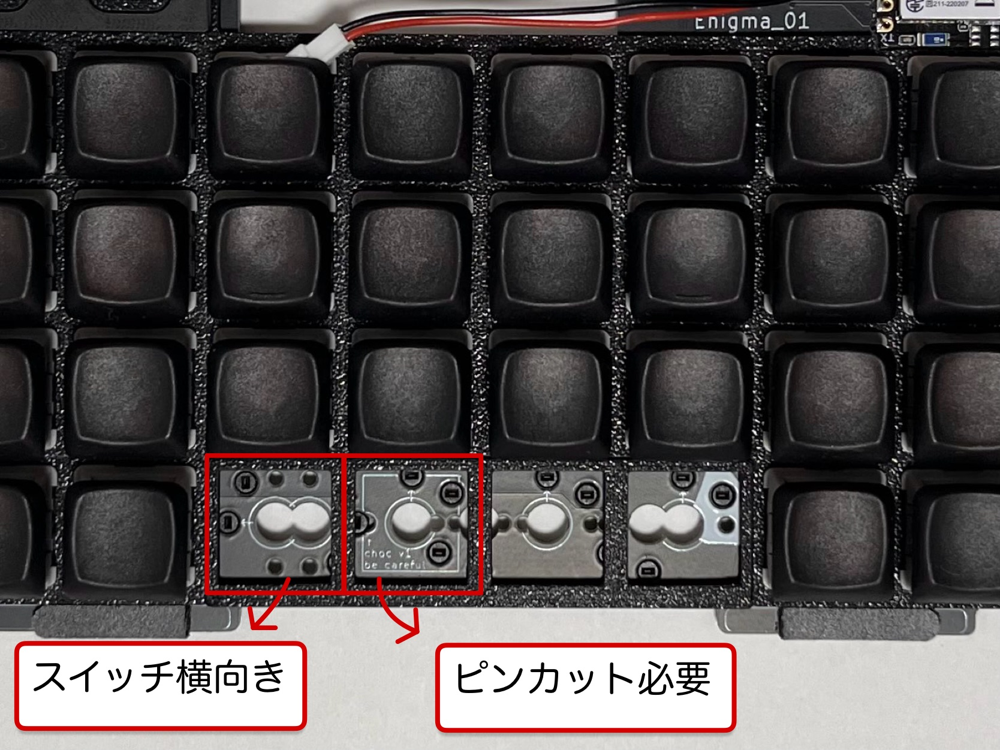
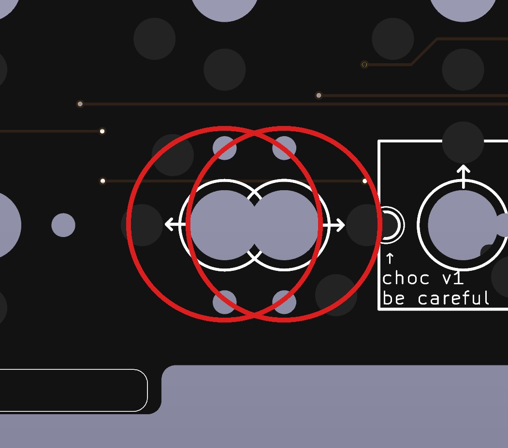

# choc v1 注意事項  
狭ピッチ×複数配列という設計上、choc v1キースイッチを使用する場合は、以下の注意点があります。  

## 1.0u配列のみ対応  
狭ピッチに対応した市販キーキャップは1.0uしか見当たりません。1.5u配列、2.0u配列を利用する場合はchoc v2キースイッチを使用してください。

## ピンカット
1.0u配列でchoc v1を使用する場合は、1箇所ピンカットする必要があります。
> PCBソケットを取り外すことでピンカットは不要なため事前にお申し付けください。  

TODO: ピンカットする位置の写真（どのスイッチの、どちらのピンか）。
<!-- 写真 v1_pincut.jpg：ピンカットするスイッチの裏の接写。切るピンを赤丸で示す。切る前と切った後を並べる -->

## 取付向き
どの配列でも最下段左から5番目のスイッチを横向き(90°)に取り付けます。それに伴い**キーキャップの印字も横向き**になります。アルファベットが印字されたキーキャップを割り当てることには不向きですので注意してください。

<!-- 絵 draw_choc_v1_sideways（自動生成）：最下段で、PCBソケットが90°回っている位置（赤丸。基板の SW16＝1.0u配列・SW43＝1.5u配列）。基板の「choc v1 be careful」の印刷のそば。TODO: 本文の「左から5番目」と、基板の列（SW16 は左から4列目）の数え方が合っているか確認 -->
