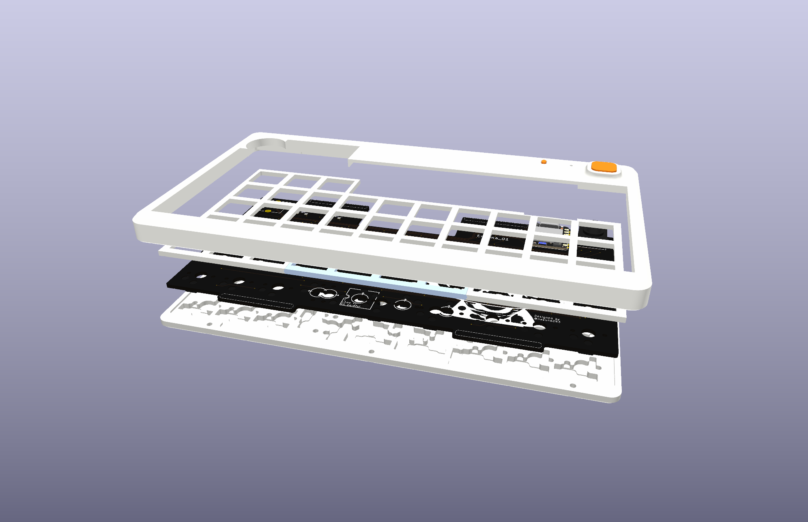
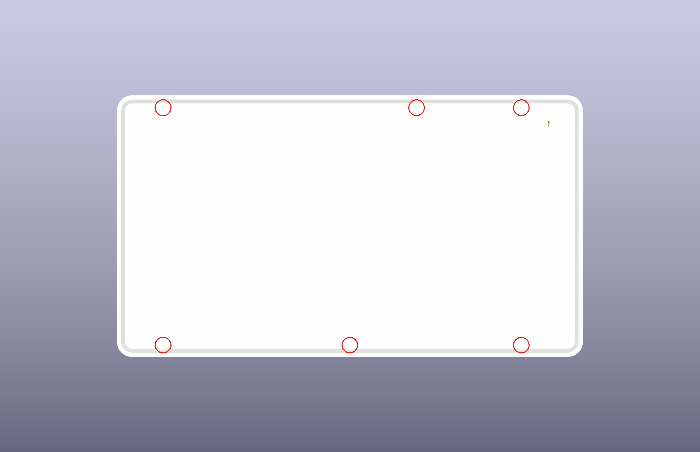

<!-- nav -->
[Enigma_01 ビルドガイド](build-guide.md) ＞ 人によって行う作業
<!-- /nav -->

# 分解と組み立て直し

<!-- before -->
> [!NOTE]
> **この作業の前に**：電源を切り、USB-Cケーブルを抜く  
> **使う道具**：プラスドライバー（M2）・マスキングテープ  
> **難しさ**：低
<!-- /before -->

組み上げた後に、親指キーの配列変更やリポバッテリーの取付で本体を開けるときの手順です。初めて組むときは、ビルドガイドの [6章](build-guide.md#6-ケースへの組み立て)に沿って進めてください。

> 下から、ボトムケース・基板・トッププレート（親指キーのプレートは差し替え式）・アッパーケースの順に重なっています。電源ボタンとリセットボタンはアッパーケース側の小さな部品です（図のオレンジ）。

## 必要なもの
・プラスドライバー（M2ネジ用）  
・キープラー（キースイッチを外す場合）  
・マスキングテープ（電源ボタンの仮止め用）

## 分解の手順
1. 電源を切り、USB-Cケーブルを抜く。
2. 本体を裏返し、ネジ6本を外す。  

<!-- 写真 disasm_screws.jpg：裏返した本体と、外したネジ6本を小皿に入れた様子を真上から -->

3. ボトムケースを外し、基板を取り出す。電源ボタンは小さく外れやすいので、なくさないように置いておく。  
<!-- 写真 disasm_open.jpg：アッパーケースから基板を持ち上げたところを斜め45度から。電源ボタンの部品が写るように -->
<!-- 写真 disasm_power_button.jpg：外れた電源ボタンの部品を指先に乗せた接写（大きさが分かるように） -->

## 組み立て直しの手順
1. 電源ボタンをアッパーケースの穴に入れ、マスキングテープで留めておく。
<!-- 写真 asm_tape.jpg：アッパーケースの裏側で、電源ボタンをテープで留めた接写 -->

2. アッパーケースを裏返して置き、基板を入れる。USB端子をケースの切り欠きに先に合わせてから、基板を寝かせる。
> [!TIP]
> ボトムケースに部品を組み付けるより、アッパーケースを裏返して組み付ける方がUSB端子を納めやすいです。

<!-- 写真 asm_usb.jpg：裏返したアッパーケースに、USB端子側から基板を差し入れる手元を斜めから -->

3. リポバッテリーを付けている場合は、両面テープで留めたまま、導線がケースのはめ合わせに挟まらないように通す。
4. ボトムケースをかぶせ、基板・USB-C・バッテリーの収まりを確認する。
5. ネジ6本を締める。締めすぎるとケースが割れることがあるので、止まったところで止める。
6. 電源を入れ、キーの入力を確認する。

## 関連
- [親指キーの配列](thumb_key.md)
- [リポバッテリー取付方法](battery.md)

---

[← ビルドガイドの目次に戻る](build-guide.md#目次)
