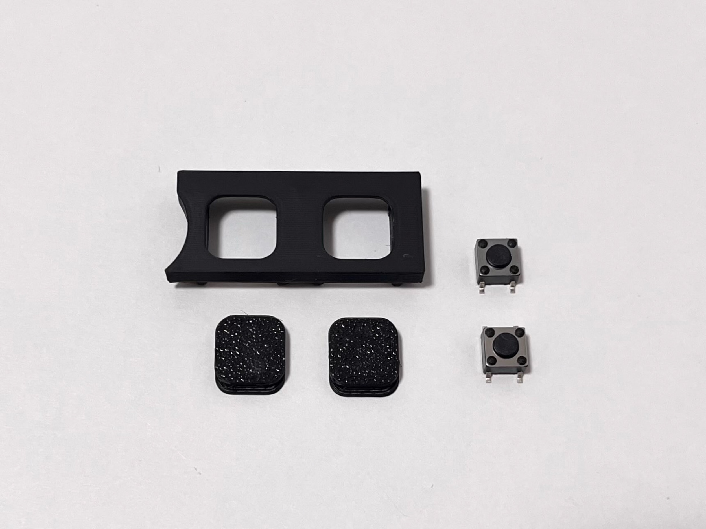

<!-- nav -->
[Enigma_01 ユーザーガイド](user-guide.md) ＞ 必要なときに見るページ
<!-- /nav -->

# タクトスイッチキット 部品表

|部品名|数|備考|
|:-|:-|:-| 
|タクトスイッチ|×2|1sw-016|
|スイッチカバー(ボディ)|×1||
|スイッチカバー(ボタン)|×2||

<!-- nav -->
---

[← 商品内容（README）](../README.md#2-1-商品内容) ｜ [タクトスイッチ取り付け](tact_sw.md) ｜ [ユーザーガイド](user-guide.md)
<!-- /nav -->
