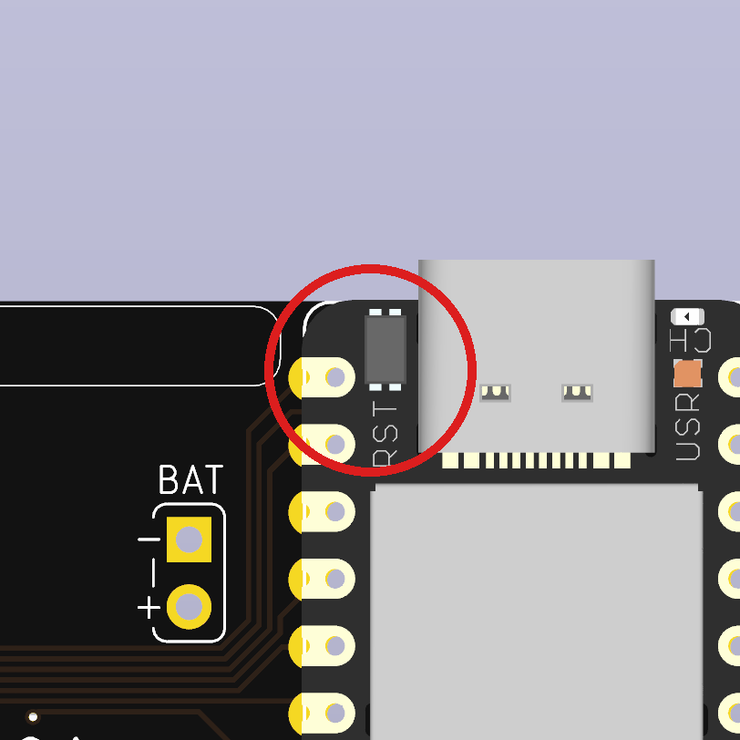

<!-- nav -->
[Enigma_01 ユーザーガイド](user-guide.md)
<!-- /nav -->

本体を分解せずXIAO BLEのリセットボタンを押せるようにアッパーケースにリセットボタンを設けています。
アッパーボタン📷
<!-- 絵 draw_reset_upper（自動生成）：アッパーケースのリセットボタン（赤丸） -->

マイコンボタン📷
<!-- 絵 draw_reset_xiao（自動生成）：ケースを外した状態。XIAO の RST ボタンと、アッパーのボタンが当たる位置（赤丸） -->

ただしガスケットマウントのため、XIAO BLEのリセットボタンとアッパーケースのリセットボタンの位置がズレて上手く押せない場合があります。

そういう場合は、基板を手前方向にズラすことで上手く押せるようになります。
ズラす図
<!-- 絵 draw_reset_shift（自動生成）：基板を手前（キーの側）にずらす向き（矢印）。オレンジはアッパーケースのリセットボタンの位置 -->

USB端子用の切り欠きからもリセットボタンが少し見えますので、目視でも位置確認をしてみてください。
目視の図📷
<!-- 写真 reset_peek.jpg：本体の奥側から、USB端子の切り欠き越しにXIAOのリセットボタンが見える様子の接写 -->

詳しい分解の手順は[分解と組み立て直し](disassembly.md)です。

<!-- nav -->
---

[ユーザーガイド](user-guide.md) ｜ [← タクトスイッチ](tact_sw.md) ｜ [choc v1 注意事項 →](choc_v1.md)
<!-- /nav -->
