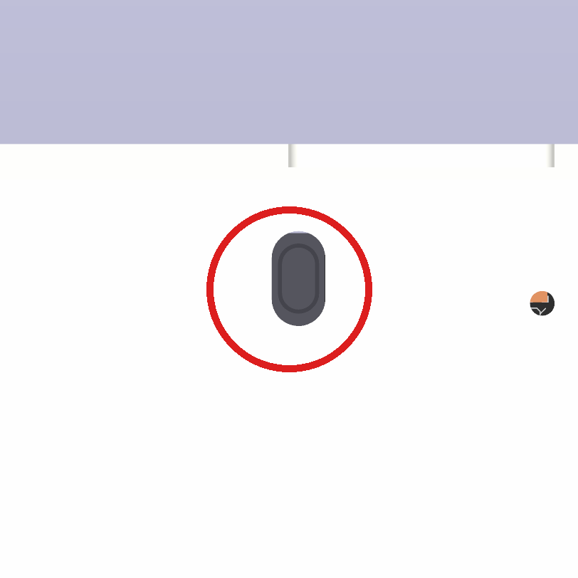

本体を分解せずXIAO BLEのリセットボタンを押せるようにアッパーケースにリセットボタンを設けています。
アッパーボタン📷
<!-- 絵 draw_reset_upper（自動生成）：アッパーケースのリセットボタン（赤丸） -->

マイコンボタン📷
<!-- 絵 draw_reset_xiao（自動生成）：ケースを外した状態。XIAO の RST ボタンと、アッパーのボタンが当たる位置（赤丸） -->

ただしガスケットマウントのため、XIAO BLEのリセットボタンとアッパーケースのリセットボタンの位置がズレて上手く押せない場合があります。

そういう場合は、基板を手前方向にズラすことで上手く押せるようになります。
ズラす図
USB端子用の切り欠きからもリセットボタンが少し見えますので、目視でも位置確認をしてみてください。
目視の図📷