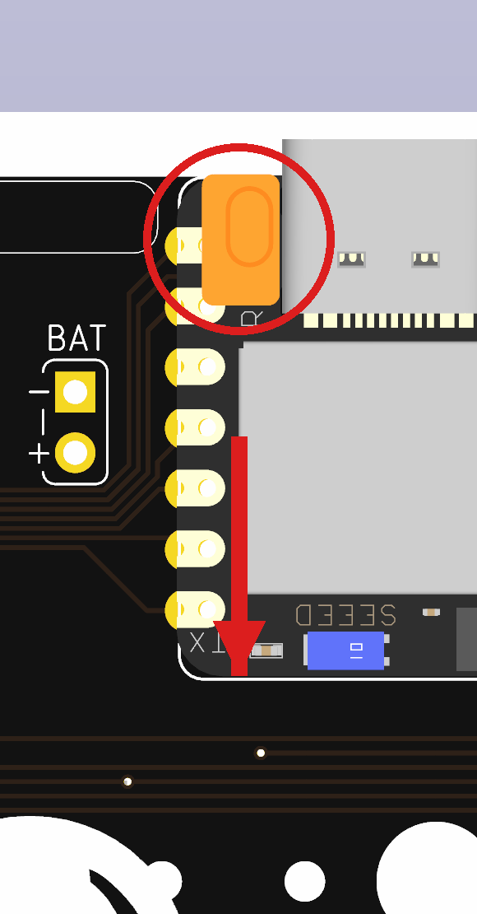

[Enigma_01 ビルドガイド](build-guide.md) ＞ 人によって行う作業

# リセットボタン

<!-- before -->
> [!NOTE]
> **この作業の前に**：なし（押しにくいときだけ分解）  
> **使う道具**：なし  
> **難しさ**：低
<!-- /before -->

本体を分解せずXIAO BLEのリセットボタンを押せるようにアッパーケースにリセットボタンを設けています。
アッパーボタン📷
<!-- 絵 draw_reset_upper（自動生成）：アッパーケースのリセットボタン（赤丸） -->

マイコンボタン📷
<!-- 絵 draw_reset_xiao（自動生成）：ケースを外した状態。XIAO の RST ボタンと、アッパーのボタンが当たる位置（赤丸） -->

ただし、基板がケースの中で少しずれていると、XIAO BLEのリセットボタンとアッパーケースのリセットボタンの位置が合わず、上手く押せない場合があります。

そういう場合は、基板を手前方向にズラすことで上手く押せるようになります。
ズラす図
<!-- 絵 draw_reset_shift（自動生成）：基板を手前（キーの側）にずらす向き（矢印）。オレンジはアッパーケースのリセットボタンの位置 -->

USB端子用の切り欠きからもリセットボタンが少し見えますので、目視でも位置確認をしてみてください。
目視の図📷
<!-- 写真 reset_peek.jpg：本体の奥側から、USB端子の切り欠き越しにXIAOのリセットボタンが見える様子の接写 -->

詳しい分解の手順は[分解と組み立て直し](disassembly.md)です。

---

[← ビルドガイド 7-2 に戻る](build-guide.md#7-2-ファームの書き換え) ｜ [目次](build-guide.md#目次)
