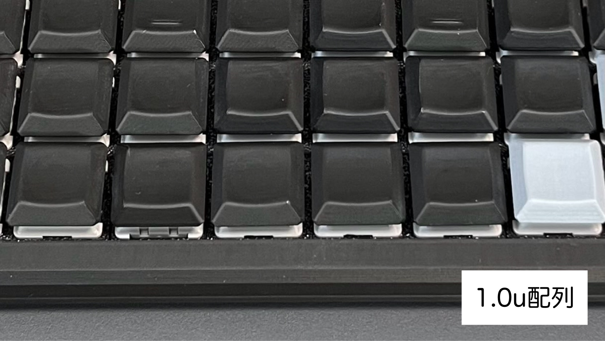
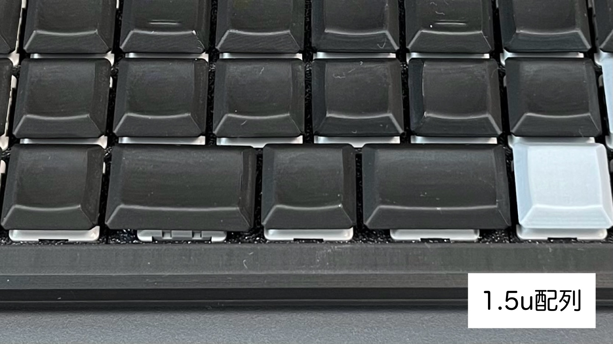
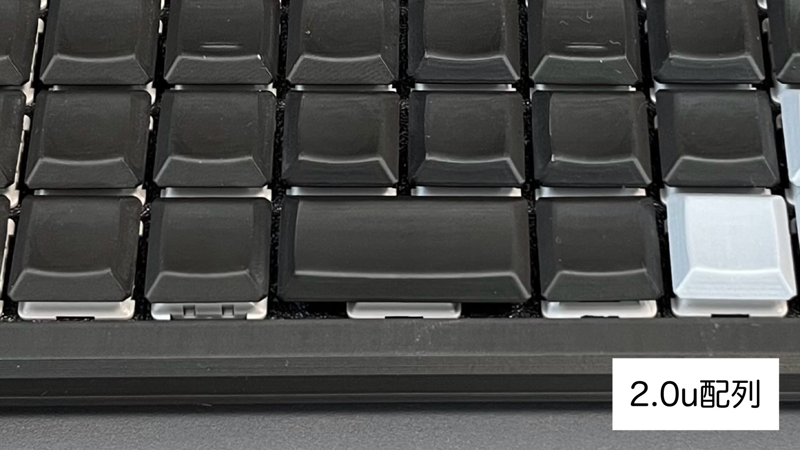
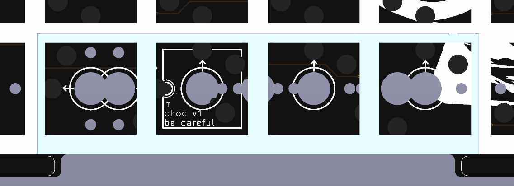
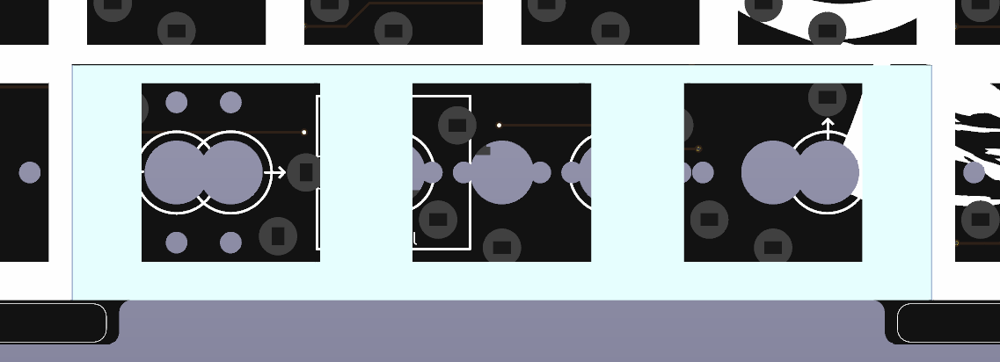
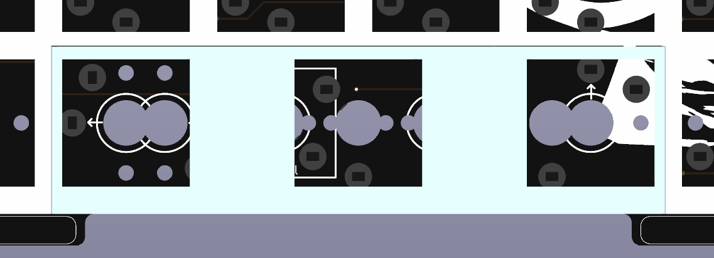
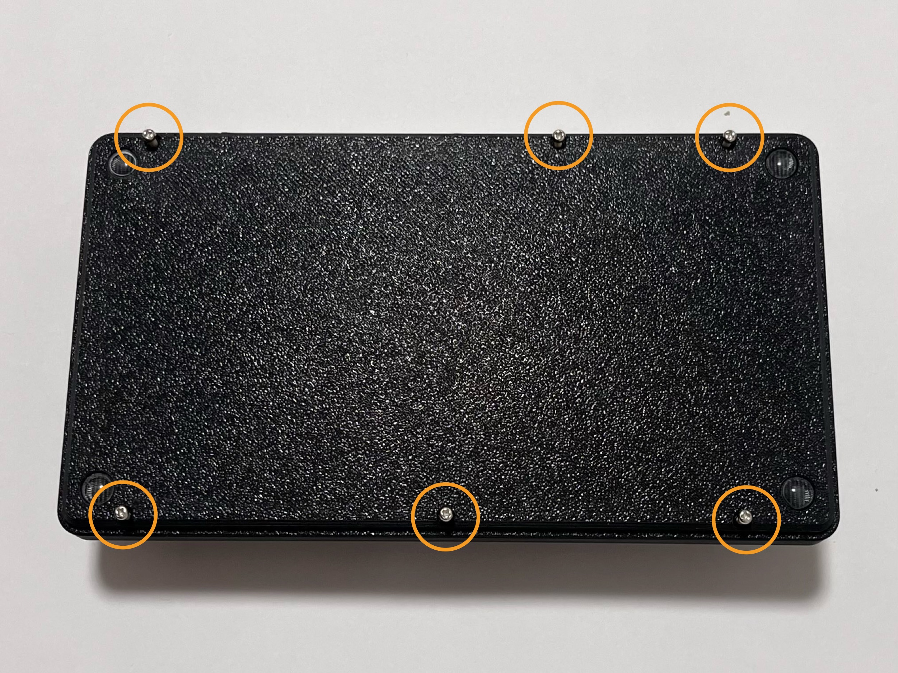
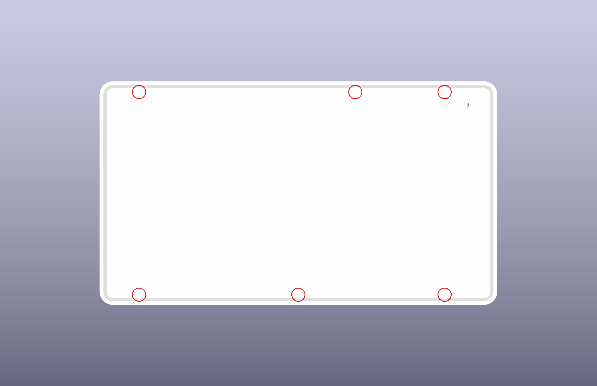
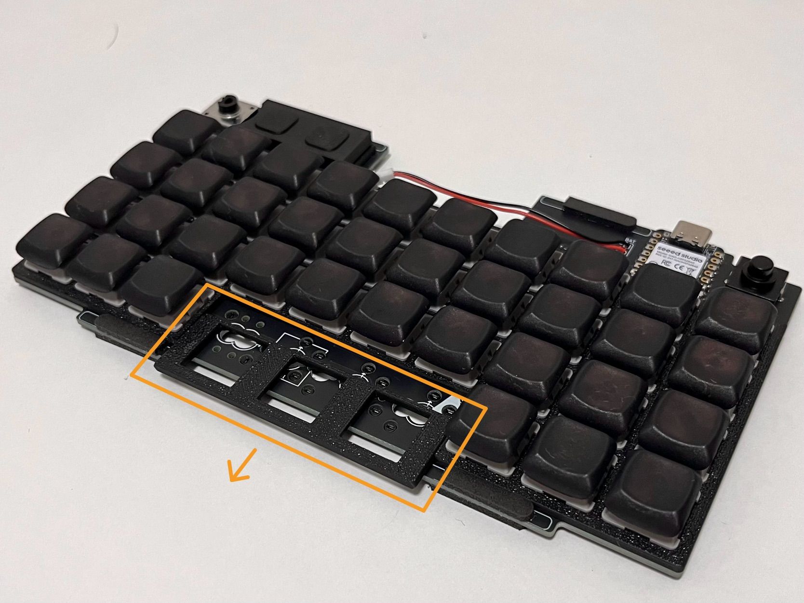

<!-- nav -->
[Enigma_01 ユーザーガイド](user-guide.md) ＞ 必要なときに見るページ
<!-- /nav -->

# 親指キーの配列

<!-- before -->
> [!NOTE]
> **この作業の前に**：[分解と組み立て直し](disassembly.md)、配列に合った[ファームウェアの書き込み](firmware.md)  
> **使う道具**：プラスドライバー（M2）・キープラー  
> **難しさ**：中
<!-- /before -->

トッププレートを交換することで親指キー（最下段の中央4キー）の配列を変更することができます。

<!-- 絵 draw_thumb_a/b/c（自動生成）：親指キーのトッププレート（青みの部分）を真上から -->
|1.0u配列（layout_a）|1.5u配列（layout_b）|2.0u配列（layout_c）|
|:-:|:-:|:-:|
||||

ファームウェアも
|ファームウェア(.uf2)|配列|  
|:-|:-|  
|Enigma_01 layout_a|1.0u配列|  
|Enigma_01 layout_b|1.5u配列|  
|Enigma_01 layout_c|2.0u配列|

## 必要なもの
・親指キートッププレート  
・キープラー  
・プラスドライバー  

## 変更手順
分解と組み立て直しの詳しい手順は[こちら](disassembly.md)、ファームウェアの書き込み方は[こちら](firmware.md)です。

1. 親指キーのキーキャップ、キースイッチを取り外す。
2. 本体裏のネジ6本を外して、基板を取り出す。※ネジ、電源ボタンの紛失に注意。  

<!-- 絵 draw_backside_screws（自動生成）：本体の裏のネジ6本の位置 -->

3. 親指キーのトッププレートをスライドさせて交換する。  

4. 基板をケースに戻して収まりを確認する。※電源ボタンをテープで留めておくのがコツ。  
> [!TIP]
> ボトムケースに部品を組み付けるより、アッパーケースを裏返して、部品を組み付ける方がUSB端子を納めやすいです。
5. 基板、USB-C、バッテリーの収まりを確認してネジ止めする。  
6. 親指キーのキーキャップ、キースイッチを取り付ける。

<!-- nav -->
---

[← ユーザーガイドに戻る](user-guide.md#設定を変える)
<!-- /nav -->
