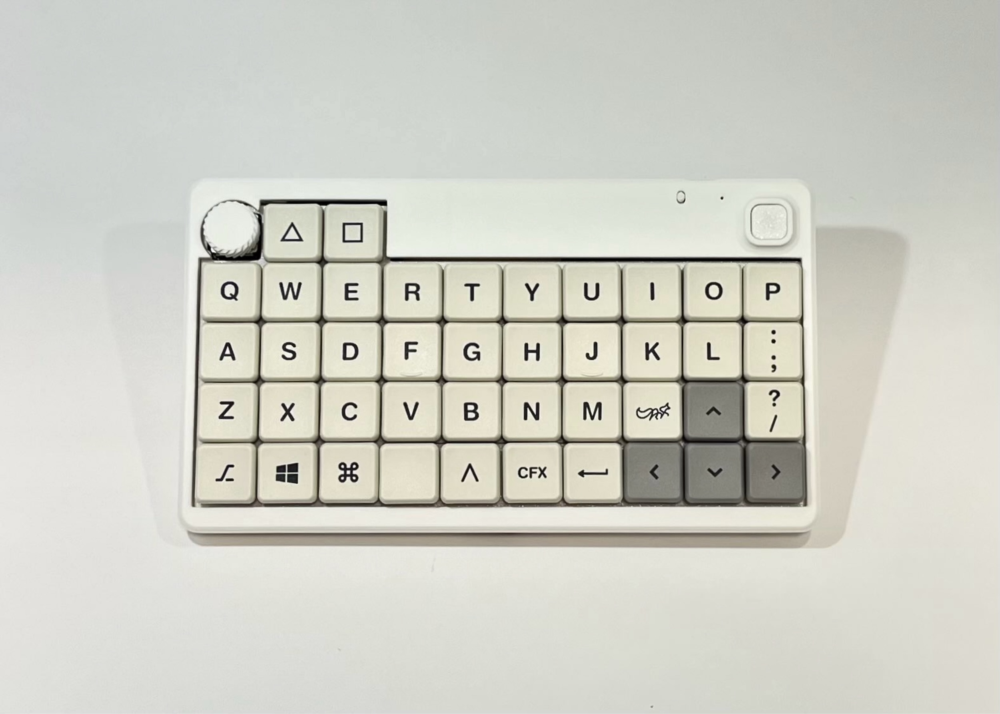
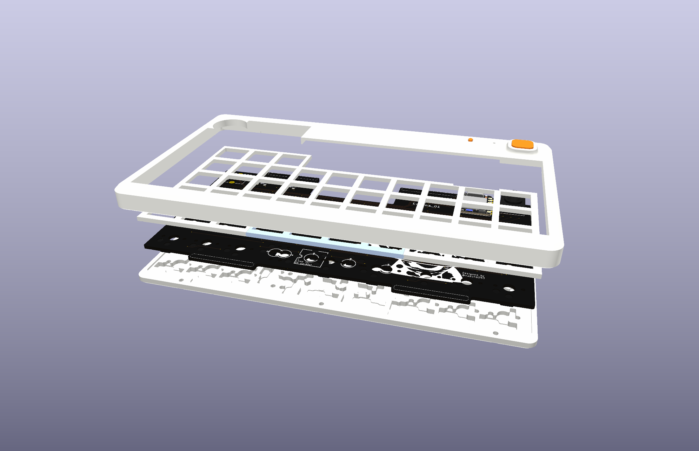

# Enigma_01 ユーザーガイド

## はじめに
Enigma_01は組み立て済みでお届けします。**はんだ付けは必要ありません。**  
このガイドでは、届いてから使い始めるまでを順に説明します。まずは「組み立てとパソコンとの接続」と「動作の確認」までを進めてください。親指キーの配列変更やリポバッテリーの取付は、そのあとで大丈夫です。

## 商品内容の確認
届いた物は [商品内容](../README.md#2-1-商品内容) と、[本体の部品表](parts_main.md) で確認できます。

### お客様でご用意いただくもの
|商品|数|備考|
|:-|:-|:-|
|キースイッチ|39〜42個|Choc v1、Choc v2（Kailh、Lofree）。Choc v1は[注意事項](choc_v1.md)あり|
|USB-Cケーブル|1本|接続・充電用。ファームの書き込みにはデータ通信ができるもの|
|リポバッテリー（任意）|1個|無線で使う場合。[取付方法](battery.md)|

## 組み立てとパソコンとの接続

### 01 キースイッチの取り付け
ピンがまっすぐか確かめてから、トッププレートの上から真上に押し込みます。斜めに押し込むとピンが曲がり、そのキーが反応しなくなります。  
詳しくは [キースイッチ・キーキャップの取り付け](keyswitch.md) です。

### 02 キーキャップの取り付け
付属のキーキャップは、3Dプリントの積層が縦になる向きに付けると手触りが良くなります。親指キーは、配列（1.0u／1.5u／2.0u）に合った幅のものを付けます。

### 03 電源を入れる
アッパーケースの右奥にある電源ボタンを押します（図のオレンジ）。XIAOのLEDが光れば電源が入っています。  
USBだけで使う場合も、電源はオンにしてください。リポバッテリーは、電源がオンのときだけ充電されます。

<!-- 絵 draw_parts_exploded（自動生成）：電源ボタンとリセットボタンはオレンジ -->

### 04 パソコンとつなぐ
**有線**：USB-Cケーブルでパソコンとつなぐと、自動で認識されます。

**無線（Bluetooth）**
1. パソコンのBluetoothの設定で、Enigma_01を選んでペアリングする（1台目は `BT_SEL0`）
2. 2台目以降は、`BT_SEL1`〜`BT_SEL4` で切り替えてからペアリングする

> ペアリング情報は `BT_CLR_ALL` で消せます。

## 動作を確認する
1. メモ帳などを開き、全部のキーを1つずつ押して、入力されることを確かめる
2. ロータリーエンコーダを回して、入力が出ることを確かめる
3. XIAOのLEDの色でバッテリー残量を確かめる（🟩30%以上、🟨10%以上、🟥それ未満）

反応しないキーがあるときは、まずそのキースイッチのピンを確認してください（[うまく動かないとき](troubleshooting.md)）。

## 設定を変える
|やりたいこと|ページ|
|:-|:-|
|キーマップを変える|[ユーザー向けリポジトリ](https://github.com/nazuna293/zmk-Enigma_01-user-config)|
|ファームウェアを書き込む|[ファームウェアの書き込み](firmware.md)|
|親指キーの配列を変える|[親指キーの配列](thumb_key.md)|

## カスタマイズ・メンテナンス
|やりたいこと|ページ|
|:-|:-|
|本体を分解する・組み立て直す|[分解と組み立て直し](disassembly.md)|
|リポバッテリーを付ける|[リポバッテリー取付方法](battery.md)|
|最上段の2キーをタクトスイッチにする|[タクトスイッチ取り付け](tact_sw.md)|
|リセットボタンが押しにくい|[リセットボタン](reset_button.md)|
|Choc v1を使う|[choc v1 注意事項](choc_v1.md)|

## 困ったとき
症状ごとの確認方法は [うまく動かないとき](troubleshooting.md) です。  
Discordの[Enigma サポート開発](https://discord.gg/sYsCttWgKr)でも相談できます。

---

[README に戻る](../README.md) ｜ [01 キースイッチの取り付け →](keyswitch.md)
